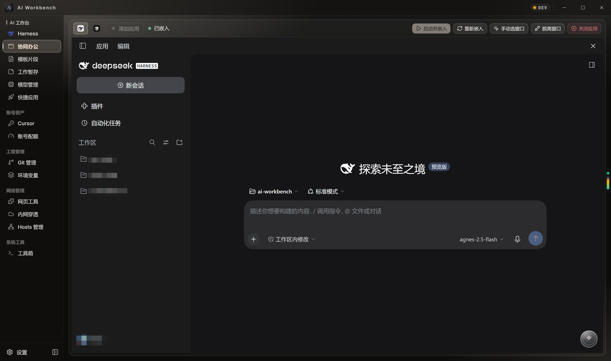

# AI Workbench (AI 工作台)

基于 **Tauri v2 + React + Rust/SQLite** 的 Windows 桌面应用，定位为 **AI 驱动的开发工具箱**。核心是 **DeepSeek 本地服务**，辅以模型配置、Git / Cursor 多身份管理，以及 Hosts、内网穿透、网页工具等能力。

## 效果图



### 应用图标

- 设计母版：[`docs/brand/logo-silver.png`](docs/brand/logo-silver.png)（默认冷银）、[`docs/brand/logo-ice.png`](docs/brand/logo-ice.png)（冰蓝备选）
- 打包默认：`src-tauri/icons/icon.png` / `icon.ico`
- 侧栏 / 加载屏：`src/assets/logo-silver.png`（`AppLogoMark`）

重新生成 Tauri 图标（使用母版 PNG）：

```bash
npx @tauri-apps/cli icon docs/brand/logo-silver.png
npx @tauri-apps/cli icon docs/brand/logo-ice.png -o src-tauri/icons/ice
```

## 功能特性

### AI 工作台

- **Harness**：启动/停止本地 `@deepseek-ai/dsh`，iframe 内嵌 Web UI；侧栏切走后保活；自定义启动端口；浏览器打开；空态内嵌「安装」按钮；可选进入页面自动启动（记忆开关）；运行中每 8 秒探测进程，外部关闭服务后状态自动回落
- **快问**：托盘常驻；默认 `Ctrl+Alt+K`；桌面浮漂；流式问答；多轮追问 / 重新生成；可选工作区 / Git / Dirty / 剪贴板上下文
- **模型配置**：多厂商与 OpenAI 兼容接口；增删改查、连接测试、批量测试/同步/删除、分组视图（按提供商纵向面板，组头失败 / 未测试计数，可一键展开折叠；扁平与分组共用 `auto-fill minmax(min(100%, 340px), 1fr)` 卡片网格）、同步 DSH；批量测试并发 4 路并显示进度，结果落库；按测试状态筛选与排序；随机度 / 最长输出档位化（1K→1M）。页面宽引 `--page-max-width`；工具条含搜索 / 筛选 / 「更多」(导入导出)；提供商品牌图标见 `public/ai-providers/`；窄窗工具条换行、列表独立滚动
- **片段库**：本地 CRUD，`{{param}}` 替换后复制或插入快问；JSON 导入导出、克隆；卡片网格 `auto-fill minmax(min(100%, 320px), 1fr)`；类型分段筛选、固定 4 行预览、双击/回车使用
- **AI 提示词**（独立页面已暂时下线；`PromptOptimizer.tsx` 保留，快问「优化提示词」仍可用）

### 账号与 Git

- **Cursor**：多账号一键切换 —— `%APPDATA%\Cursor` 为**单一数据源**，工作区 / 历史 / 扩展 / Agent 数据 / Composer 会话只存一份，账号 profile 只是指向它的 junction 壳；切换账号只替换共享库里的 `cursorAuth/*` 登录键（各账号登录态快照单独保存在 `cursor-backups/<id>/auth.json`），互不覆盖；磁盘占用可视化 + DB 瘦身（VACUUM + 移除旧共享层）；可检测并清理 Cursor 自更新中断留下的陈旧标记（否则每次启动弹「拒绝访问 os error 5」，清理为**移出可还原**而非删除）；可选本机密码备忘，支持诊断导出。Git 身份在「Git 管理」页按仓库 / 域名配置，与 Cursor 账号切换互不影响
- **WorkBuddy**（独立页面已暂时下线，扫码加号 / 签到 / 自动签到设置 / 积分查询都在「账号额度」页；以下为页面代码仍保留的能力）：腾讯 CodeBuddy 账号池管理控制台。扫码/粘贴纳管多个账号（凭证本机明文入库，界面只显示掩码）、每日自动签到（串行 + 账号间隔 2 秒防风控，连败 5 次自动停用）、签到状态卡（连登 / 周进度 / 账户积分余额）；上游登录页 / 签到 / 积分端点全部走可编辑的协议 JSON（`wb_settings.adapter_json`），改协议不需要重新构建；协议面板顶部的**接口探针**会在登录窗里记录页面自己发出的接口调用（只记方法 / 路径 / 状态码 / 认证头名，不记任何值），点一下即可写入对应端点配置
- **账号额度**：看板卡片统一展示各账号的剩余额度——一个账号一张卡（身份 / 套餐徽标 / 紧凑倒计时如 `21d10h`），进度条一律按**剩余**填充，余量低时转黄 / 红。WorkBuddy 按积分包拆成「套餐基础积分」「平台奖励积分」两行（走 creditSummary 协议端点，挂风控盾所以进页面不自动查询，全部手动刷新）；所有卡片都来自看板里的「授权登录」，不再读本机其他应用的登录态，每个授权账号一张卡（卡片头的人形 + 可再加一个账号）：Cursor 走 Cursor 官方浏览器登录（`cursor.com/loginDeepControl` + PKCE，后台轮询 `api2.cursor.sh/auth/poll` 取令牌）拉当前账期，主条个人与团队同一口径，与 Cursor 设置页「Included in Pro / Team」的 Total 一致（`totalPercentUsed`，明细是 Cursor 模型 / 其他模型两个池；编辑器底部用量条与「used N%」提示按套餐花费 / 限额算，是 Cursor 自己的另一套口径，放在明细「套餐额度」里）；`spendLimitUsage` 是按量付费预算而非套餐额度，个人（`individualUsed/Limit`）与团队（`pooledUsed/Limit`）开了或花过才单列；团队 / 个人标签按 `membershipType`（enterprise 即团队席位）判断，金额上游是美分，套餐内花费（`includedSpend`）与套餐外赠送用量（`bonusSpend`）分开显示；Grok Bot 是 Cursor 账号体系，用同一套浏览器登录拉用量与下次重置时间；WorkBuddy 的 + 直接弹出扫码登录（与 WorkBuddy 页同一套 `ScanAddFlow`）把账号加入账号池；DeepSeek 没有授权链接，填开放平台 API Key（先查一次 `/user/balance` 验证通过才保存）显示充值 / 赠送余额；接口没有总额，进度条以最近一次充值后见过的最高余额为满（本机 localStorage q-ds-peak，余额上涨即上调）；Qoder（国内版 qoder.cn）走 Qoder 客户端同款设备授权（浏览器打开 `qoder.cn/device/selectAccounts` + PKCE，后台轮询 `openapi.qoder.com.cn/api/v1/deviceToken/poll` 取令牌），查 `/sash/api/v2/me/usage` 按 Qoder「我的用量」把套餐内 Credits 与资源包各画一条（资源包有额度时，空的套餐池也画成 0% 条，卡片整体状态按两池之和），另列团队共享包与套餐到期，企业版只给网页链接；令牌约 1 小时过期，临期或被拒时用 `deviceToken/refresh` 自动续期，续期也被拒才提示重新授权；同时查 `/sash/api/v1/me/campaigns` 显示每日积分活动（可领 N Credits + 截止时间 / 已领取，工具条摘要统计可领个数），点「领取」只直调一次 `campaigns/{id}/claim`（不重试、不定时自动领），失败——多半是服务端风控要求 Qoder 客户端的设备身份（`RISK_BLOCKED`）——就自动启动本机 Qoder CN（按注册表卸载项定位）由客户端弹出领取页，找不到客户端再打开官网。Cursor / Grok Bot / DeepSeek / Qoder 的令牌存本机 SQLite 的 `quota_accounts` 表（不进数据导出）；Codex 走链接授权（与 EchoBird 一致）：在右侧点 ChatGPT / Codex 的 +，应用用与 Codex CLI 相同的 OAuth（PKCE）流程打开浏览器登录 ChatGPT，回调本机 `localhost:1455` 后把这套令牌存进本机 SQLite 的 `codex_accounts` 表（不进数据导出），每个授权账号一张卡，展示 5 小时与每周两档限额及各自重置倒计时；令牌临期自动续期，且是应用自己的一套，不影响本机 Codex 的登录。所有令牌都不回显到前端。查询结果按卡片缓存在本机 localStorage q-cache（结果里不含令牌），切页回来立刻有数；进页面时自动重查授权类账号里超过 10 分钟的结果，每张卡独立转圈、底部显示「N 分钟前」，倒计时每分钟走一次。工具条「全部刷新」只并行查授权类账号，WorkBuddy 另有「刷新 WorkBuddy」按钮（串行、只手动）；WorkBuddy 卡片上有签到条（今日已签 / 未签 / 失败 / 已被自动停用，状态只读账号表的上次签到记录、不额外调风控端点），可单卡签到或在工具条「全部签到」逐个签到（间隔 2 秒），签到成功后自动刷新该账号积分，卡片底部提示每日自动签到时间，工具条「自动 09:30」按钮点开弹层可直接开关每日自动签到、改时间（与 WorkBuddy 页签到区是同一份设置，协议未配置 checkin 端点时禁用）；旁边的摘要统计账号数 / 余量低 / 需重新授权 / 查询失败，点异常项直接定位到卡片。令牌失效时卡片显示「授权已过期」并就地给出「重新授权」（后端按身份去重，更新的仍是原卡片），DeepSeek Key 被拒时给出「更换 Key」（新 Key 验证通过才替换旧的）。卡片头的垃圾桶是「删除授权」（删本机令牌，需确认）；WorkBuddy 卡与未授权空卡另有「从看板隐藏」（单个 WorkBuddy 账号记在 q-hidden；WorkBuddy 卡的垃圾桶删的是账号池里的该账号）。网络不通时卡片错误条显示「网络不通，请检查网络或代理后重试」（后端 `friendly_http_error`，前端对旧缓存再清洗）。页面右侧是服务商栏，兼做账号管理：「账号及订阅服务商」按服务商列出已连接账号与状态点，点击取消隐藏并定位卡片；「添加账号」目录列出常见 AI 服务商（本机安装图标优先，否则用 `src/assets/providers/` 打包品牌图），外链在浏览器打开官网；整行或 + 永远是**新增一个账号**（Codex / Cursor / Grok Bot 打开浏览器授权，WorkBuddy 弹扫码，DeepSeek 弹出 Key 表单），右侧数字是已连接账号数，眼睛按钮单独控制该服务商是否上看板（q-cards）；卡片左上角的手柄可拖动调整顺序（q-card-order）；其余服务商暂不支持额度查询，单独列在「更多服务商」一节（默认折叠），只保留外链；整栏可收起成图标条（q-rail-collapsed），图标上带账号数与最差状态点
- **Git 管理**：仓库总览 / 扫描 / 搜索 / 批量身份 / 批量拉推 / 批量移除；提交页多仓变更、diff、提交与推送、AI 生成说明；账号支持按域名绑定（origin 自动匹配），身份匹配顺序：路径精确绑定 > 域名绑定 > 全局 git config。仓库状态由后端 `git_summarize_repos` 一次批量读取（每仓 2 个 git 进程、单进程 4s 超时），仓库页与提交页共享同一份缓存、缓存优先渲染 + 后台静默刷新；批量推送前会列出「落后会被拒绝」和「无上游将首次发布远端分支」的仓库供确认；刷新不会覆盖你取消勾选的文件
- **Git 报告**：左侧仓库 / 工作区树 + 右侧五视图报告（概览、改动文件、提交、API、AI）；改动基准可选未提交改动 / 相对基准 / 最近 N 个提交 / 指定日期区间（两端含当日）；按 Git diff 静态推导模块 / 层级 / 风险 / 缺测 / 接口变更，选中工作区文件夹可把同夹多仓合并成一份报告；支持文件路径搜索、层级 / 风险筛选、高风险摘要一键定位、仓库模式记忆；AI 可粘贴需求 / 验收标准，据此追加「需求覆盖对照」并把「必测场景」输出为 P0/P1/P2 用例卡片（优先级 / 前置 / 步骤 / 预期），整份报告含需求原文可导出 Markdown；AI 结论生成成功即留存本机历史（按目标 / 基准 / 模型 / 需求快照归档，最多 50 条）可回看与复制。报告本体不落库、不执行测试

### 开发环境

- **版本切换**：本机开发运行时相关能力；运行时卡片列表列数随窗口自适应（`auto-fill minmax(min(100%, 340px), 1fr)`）

### 系统工具

- **小工具**：8 个开发常用工具，按「转换 / 生成 / 解析」分组——JSON（格式化 / 压缩 / 修复 / JSONPath / 历史）、编解码（Base64 / Base64URL / URL）、时间戳（秒 / 毫秒 / 微秒互转 + 实时时钟）、Cron（解析 + 自然语言 + 下次执行 + 模板）、UUID（批量生成 + 校验）、Hash（SHA-1/256/384/512 + 对比）、JWT（解码 + 过期状态）、正则（实时匹配 + 分组 + 替换）。顶部工具条一行平铺全部工具（分组以分隔线区分，悬停显示分组与说明），右侧搜索过滤（当前工具说明跟在后面，≤1200px 视口隐藏），不再有第二条"当前工具"横条；窄窗口时工具条横向滚动并自动把当前工具滚入视野；`1-8` 数字键快速切换；工具页共用同一套尺寸策略（宽度只在 `.devtools-tool` 定一次：随窗口流式、超宽屏封顶 1440px；输入/输出区按 flex 长高填满窗口，时间戳的单行 input 保持自然高），textarea 不再手动拖拽改高）；这页**不保活**——切走即卸载，只用 localStorage（`workbench-devtools-tool`）记住当前停在哪个工具，工具内的输入会丢。**HTTP 客户端已移除**（原「网络」分组、`devtools_http_request` 命令与 `http_saved_requests` / `http_history` 两张表一并删掉，旧库里的表在启动时被 `DROP TABLE`）
- **Hosts管理**：读写系统 hosts，手动/自动备份与恢复，另存为配置（需管理员）；系统编辑器高度随窗口变化（`clamp(300px, 45vh, 560px)`，不再钉死 300px）
- **内网穿透**：cloudflared 临时/命名隧道；日志过滤/导出；公网 URL 浏览器打开；详见 [docs/cloudflared.md](docs/cloudflared.md)
- **快捷应用**：保存常用应用路径（名称 / exe / 启动参数 / 分组 / 版本），一键启动与关闭。「添加应用」直接打开扫描弹窗（注册表 + 安装目录 + 开始菜单/桌面快捷方式，直接解析 .lnk 二进制，覆盖其他盘符与深层布局，并对 Codex / Claude Code 等无注册表、无快捷方式的 per-user CLI 工具走一份可扩充的精选清单，自动识别主程序、读取程序版本、带真实图标）批量导入，弹窗底部「手动添加…」唤起表单；运行时状态检测（tasklist 批量查询 + 可选 5 秒自动刷新）、单个/批量关闭（先礼后兵：正常退出超时再强杀）；拖拽排序 + 排序方式（自定义 / 名称 / 分组 / 运行中优先）、自定义分组（分组管理器新建/重命名/删除，重命名与删除会同步到应用；分组列表存 localStorage `al-groups`，归属仍在应用的 `group` 字段入库；筛选下拉展示空分组，表单可选/建分组，多选可批量设置分组）、搜索、多选批量启动/删除；应用版本自动读取（Win32 文件版本资源，卡片上直接展示，可手动覆盖）；JSON 导入导出（按路径去重）；原生文件选择器浏览 exe。卡片网格随窗口宽度自适应列数（`minmax(min(100%, 260px), 1fr)`），首屏空态随窗口高度垂直居中；工具条吸顶固定（`.al-toolbar` sticky + 宿主 `.al-page-host` 去掉上内边距），只有下方卡片区域滚动；磨砂主题下这条吸顶条与侧栏同配方（`--chrome-bg` + blur 20px），卡片从它下面滚过时透出模糊。**同一页还有第二个视图「端口查杀」**（工具条左侧 `.al-view-tabs` 切换，选择记在 localStorage `al-view`）：输入一个或多个端口（支持 `3000, 5432` 与 `8080-8090` 范围粘贴，一次最多 64 个）后列出谁在监听——PID / 进程名 / 完整 exe 路径 / IPv4+IPv6 地址（双栈同一进程合并成一张卡）——确认后 `taskkill /T /F` 连进程树一起结束，并回读 netstat 验证端口确实释放；PID ≤ 4 与 csrss / lsass / svchost 等关键进程前端不给按钮、后端同样直接拒绝，且只杀"点击时仍在监听该端口"的 PID（PID 会被系统回收，不做盲杀）
- **网页工具**：两个页签。**网页**——把常用站点存成书签（名称 / URL / 分组 / 标签 / 全局快捷键），地址栏可直接打开任意网址，支持分组折叠与筛选、按名称-域名-URL-标签搜索、手动拖拽排序（跨分组拖拽即改分组）与"最近使用"排序、列表 / 卡片双视图、打开次数与最近打开时间统计、JSON 导入导出（按 URL 去重）、空白时的预设一键添加；书签的**全局快捷键注册在应用层**，切到别的页面甚至最小化后依然生效，冲突或注册失败会提示。**脚本**——油猴式用户脚本（名称 / 描述 / `@match` 规则 / 代码，支持 `<all_urls>` 与 `*://example.com/*` 通配），可启用/禁用、搜索、按名称-时间-状态排序、全部启停、代码折叠预览、单条复制或导出 JSON、内置四个模板（标题显示 URL / 强制深色 / 去广告 / 字数统计），并能在编辑时输入 URL 实时预览是否命中；**从网址导入**走 Rust 侧请求（自动把 GreasyFork 页地址转成 `.user.js`、GitHub blob 转 raw），因此不受网页 `fetch` 的 CORS 限制，且会解析脚本自带的 `@name` / `@description` / `@match`。两类入口都用 Rust 创建的**独立弹窗浏览器**打开：内置浮动导航工具栏（前进 / 后退 / 刷新 / 复制地址 / 缩放 / 折叠 / 交给系统浏览器），工具栏靠 initialization script 所以在页面内部跳转后依然存在，同一地址重复点击只聚焦不重开，窗口标题栏继承当前主题；用户脚本按 `@match` 在**每次导航**时复查后再注入，不会跟着跳到别的站点继续生效。主界面书签图标取自站点自身的 `/favicon.ico`，失败时回落到按域名生成的首字母渐变图标

### 设置

- 主题：冰蓝 / 冷银 / 香槟金 / 浅色 / 深色 / 跟随系统
- 中英语言、侧栏折叠、开机自启、快问快捷键
- 启动时自动检测新版本（GitHub 为主，jsDelivr 的 GitHub tag 索引兜底；无 Gitee），均不可达则静默；右下角非阻塞提示条；点「查看更新」打开升级弹窗：**先显示这个版本的更新说明（release 正文）**，再决定升不升；弹窗内可「立即升级」（应用内下载安装包 → 显示进度可取消 → 自动关闭应用并静默装新版）、「跳过此版本」或「在浏览器中打开」；GitHub 匿名 API 配额打满时版本探测会跟发布页 302、安装包改走**不占配额的资产直链**；设置页同样可检查、升级，并可清除已跳过的版本
- 数据导出 / 导入（JSON；含明文密钥警告）

## 侧边栏导航

```
AI 工作台
├── Harness
├── 模型配置
└── 片段库

账号管理
├── Cursor
└── 账号额度

版本管理
├── Git 管理
└── 环境变量

网络管理
├── 系统hosts
├── 内网穿透
└── 网页工具

系统工具
└── 小工具

快捷应用（顶层叶子，不属于任何分组）

设置（固定在侧栏底部）
```

## 技术栈

| 层 | 技术 |
|---|---|
| 前端 | React 18 + TypeScript + Vite 5 |
| 后端 | Tauri v2 + Rust |
| 持久化 | SQLite（`rusqlite` bundled） |
| 状态 | Zustand 5 |
| 样式 | 纯 CSS（`data-theme`） |
| i18n | i18next |

## 快速开始

### 环境要求

- Node.js 18+
- Rust 1.70+
- Windows 10/11
- WebView2（Win10/11 通常已预装）

### 安装与开发

在仓库根目录执行（不要写死本机盘符路径）：

```bash
git clone <repo-url>
cd ai-workbench
npm install
npm run tauri -- dev
```

仅前端 Vite（无桌面壳）：

```bash
npm run dev
```

调试构建出的 exe（相对路径）：

```powershell
npm run tauri -- build -- --debug
Start-Process .\src-tauri\target\debug\ai_workbench.exe
```

## 打安装包（Windows exe）

发布前先**同步版本号**（三处保持一致）：

| 文件 | 字段 |
|------|------|
| `package.json` | `"version"` |
| `package-lock.json` | `"version"`（2 处，随 `npm install` 写入） |
| `src-tauri/tauri.conf.json` | `"version"` |
| `src-tauri/Cargo.toml` | `version`（`src-tauri/Cargo.lock` 未被 git 跟踪，构建时自动更新） |

当前版本：`0.2.8`（设置页通过 Tauri `getVersion()` 读取）。发布前务必核对上表四处一致——`src-tauri/Cargo.toml` 最容易漏（它决定 exe 文件属性里的版本号）。

### 构建

```bash
npm install
npm run tauri -- build
```

### 产物位置

| 类型 | 路径 |
|------|------|
| NSIS 安装包 | `src-tauri/target/release/bundle/nsis/*.exe` |
| MSI（若生成） | `src-tauri/target/release/bundle/msi/` |
| 便携 exe | `src-tauri/target/release/ai_workbench.exe` |

`tauri.conf.json` 中 `bundle.targets` 为 `all` 时会尝试生成常见 Windows 安装格式；日常分发优先使用 **NSIS 安装包**。

### 分发注意

- **开发标识零泄漏（打包红线）**：所有开发标识——主窗口标题 `[DEV]` 后缀（`src-tauri/src/lib.rs`，`cfg!(debug_assertions)`）、托盘提示 `[DEV]` 前缀（`src-tauri/src/tray/mod.rs`）、前端 DEV 徽标（`src/App.tsx`，`import.meta.env.DEV`）——必须是**编译期常量**，`npm run tauri -- build`（release）自动剥离；禁止改用运行时环境变量 / 配置文件 / 命令行开关控制开发标识，新增开发态 UI 一律沿用上述两处编译期机制，发版前抽查安装包运行无任何 `[DEV]` / DEV 徽标
- 需要目标机器具备 **WebView2**
- DeepSeek 功能仍依赖本机 **Node.js + npm**（全局 `@deepseek-ai/dsh`）
- 内网穿透依赖本机 `cloudflared`（应用内可安装或指定 exe）
- 修改 Hosts 需**管理员**运行
- **不要**把用户数据目录打包进安装包：`%APPDATA%\com.ai-workbench.app\`（含 SQLite 与明文密钥）
- 安装包本身不包含用户的 API Key / Token；用户数据在首次运行后写入本机

## 隐私说明

- API Key、Tunnel Token、Cursor 密码备忘、CodeBuddy 账号凭证等保存在本机 SQLite：`%APPDATA%\com.ai-workbench.app\ai-workbench.db`
- 不会上传密钥；请勿分享数据库或导出的含密钥 JSON
- 书签图标只向**目标站点自身**请求 `/favicon.ico`，不经过第三方图标服务，内网域名不会外泄
- 「网页工具 → 从网址导入」会由本机直接向你填写的脚本地址发起一次 HTTP(S) 请求（不经第三方中转）

## 免责声明

- 本项目为个人开发的本地工具，与 DeepSeek、Cloudflare、Cursor 等厂商**无任何隶属或合作关系**；相关名称与图标仅用于描述兼容对象，版权归原作者所有
- 「DSH 认证补丁」会修改本机 DeepSeek Harness 安装目录下的文件以跳过浏览器登录，**可能违反上游服务条款**；请自行评估风险，也可在 DeepSeek 页使用「还原认证补丁」恢复原始文件
- Hosts 修改、内网穿透等功能仅供合法用途，使用者需遵守当地法律法规
- 使用本项目产生的任何直接或间接风险由使用者自行承担

## 项目结构（摘要）

```
ai-workbench/
├── src/                 # React 前端（App、components、core、locales）
├── src-tauri/           # Tauri + Rust 命令（见 src/lib.rs invoke_handler）
├── docs/                # 截图、品牌图、专题文档
├── package.json
└── README.md
```

后端命令按模块拆分于 `src-tauri/src/*_commands.rs`，完整列表以 `src-tauri/src/lib.rs` 注册为准。

`src-tauri/src/bin/` 下是内部诊断工具（`cursor_switch_test`）。它们由 `dev-tools` 特性门控，**默认不参与构建**，因此不会被打进安装包；需要时用 `cargo build --features dev-tools` 单独编译。

## 已知限制

1. 目前仅面向 **Windows**
2. 完整 AI 对话主要走 DeepSeek Harness；快问为轻量单发
3. DeepSeek / cloudflared 依赖本机环境
4. 敏感字段本机明文存储（见隐私说明）
5. Git 提交页基于收藏仓库扫描

## 许可

MIT
