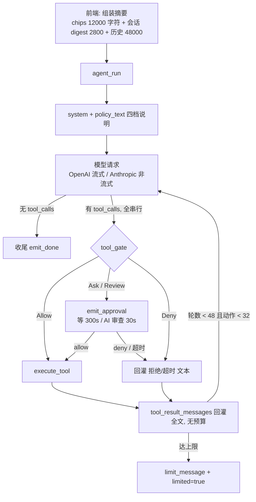

# 天玑 AI 助手：harness 能力审计与升级路线图

> 状态：评估定稿（2026-10-23）· **P0 / P1 / P2 主干全部落地**（M1–M4，实现形态与遗留项见 §4.1–4.3 各节的状态引用块与 §5.2 的剩余清单）
> 依据：`src-tauri/src/agent.rs`、`agent_policy.rs`、`agent_fs.rs`、`agent_proc.rs`、`agent_sys.rs`、`agent_computer.rs`、`agent_stream.rs`、`cancellation.rs`、`src/components/aiHub/*`、`src/components/AiHubApp.tsx`、`src-tauri/Cargo.toml` 与各文件内联单测。所有判断附 `文件:行`，行号以 0.2.34 工作区为准。
> 范围：只评「天玑 → AI 助手」这一条链路（`agent_run` 的完整闭环）；工具箱、Git 管理、协同办公等模块仅在影响 agent 能力时提及。

---

## 〇、摘要

**三句话结论**

1. **是 harness，不是套壳聊天。** 单入口 `agent_run`（`agent.rs:1499-1500`）+ 真正的 模型→工具→观察→再决策 循环（`agent.rs:1588-1832`，`MAX_ROUNDS=48` / `MAX_ACTION_STEPS=32`，`agent.rs:25-26`）+ 工具闸门 + 审批 + 取消 + 步骤流，四个 harness 要件齐备。
2. **强在治理与本机自动化，弱在循环质量与上下文治理。** 四档权限 + fail-closed + AI 前置审查 + 受保护路径 + 冲突交给人，这一维是本项目最扎实的部分（12 个单测把矩阵钉死，`agent_policy.rs:419-626`）；而 Claude Code 的核心竞争力恰好落在短板这侧：并行工具、计划、预算、生态。
3. **对标结论：编码任务"能用"，但天花板被三件事压住** —— 工具全串行且单轮不限量（`agent.rs:1656`）、上下文给模型的输入零预算（`agent.rs:1603` 每轮全量重发，只有 UI 侧截 2000，`agent.rs:29`）、工具生态为零（28 个工具硬编码，`agent.rs:129-219`，无 MCP / web / 子代理 / LSP）。

**六维评分（1-5，编码工作流口径）**

| 维度 | 分数 | 判定依据（一句话） |
|------|:---:|------|
| 执行闭环 | **4** | 有上限、有终止语义、可取消、有限流提示；扣分在没有并行、没有预算、没有退避 |
| 工具面（编码） | **3** | 读/写/改/搜/跑俱全，但 grep 不读 `.gitignore`（`agent_fs.rs:266-271`）、`find_files` 无 `**`（`agent_fs.rs:301-326`）、无 LSP / 子代理 / web |
| 治理与安全 | **5** | 四档 + fail-closed（`agent_policy.rs:28-35`）+ AI 审查（`:405-417`）+ 审批超时（`agent.rs:32`）+ 保护路径（`agent_fs.rs:159-201`）+ 回收站删除（`:560-579`） |
| 上下文工程 | **2** | 后端零裁剪零摘要，前端字符预算 + 120s TTL 缓存（`config.ts:134,153`），无 prompt cache、无 token 预算 |
| 可观测与可恢复 | **4** | `agent-step` 全量可视化（`agent.rs:303-330`）+ 流式 + 半截答案保留 + 错误卡重试；扣分在无单步取消、无撤销、无 diff 级确认 |
| 生态与扩展 | **2** | 工具表硬编码、无 MCP / 插件 / 技能 / hooks；模型层反而很开放（OpenAI + Anthropic 双协议、场景绑定、Profile） |

合计 **20 / 30（67%）**。若把"本机运维/自动化"单独算一面，那一面是 **5/5**——截屏 + 键鼠（含左上角急停）、剪贴板、进程/端口、hosts/隧道/运行时，这些是 Claude Code 完全没有的。

**建议先做的 5 项（都在 P0）**

| 顺序 | 项目 | 一句话理由 |
|:--:|------|------|
| 1 | `parse_args` 坏 JSON 不再静默执行 | 模型一个手滑，工具就以空参跑起来，报错误导下一轮 |
| 2 | 工具结果统一预算 + 截断提示 | 现在长日志/大文件是**原样**回灌模型，几轮就把上下文挤爆 |
| 3 | 只读工具并行 + 单轮调用上限 | 串行是慢 2-4 倍的根本原因，且弱模型一次发 10 个调用会逐个触发审批 |
| 4 | 429/5xx 退避 + 空响应重试扩到 4 次 | 免费/路由模型（如界面里的 `openrouter/free`）429 是常态，现在直接失败 |
| 5 | `agent_decide` 鉴权 + 待决项清理 | 任何窗口都能替用户按"允许"，是当前唯一的安全敞口 |

---

## 一、判定：它算不算 harness

### 1.1 判定标准与结论

一个 agent harness 至少要有四件事：**单入口 + 多步闭环 + 工具治理 + 可中止可观测**。逐条对照：

| 要件 | 是否具备 | 证据 |
|------|:---:|------|
| 单入口、请求自包含 | ✅ | `agent_run`（`agent.rs:1499-1500`），`AgentRunRequest`（`:47-71`）带 config/system/user/history/repoPath/services/permission/tools/vision，无需前端参与循环 |
| 多步闭环（模型↔工具↔观察） | ✅ | `loop`（`:1588-1832`），工具结果经 `tool_result_messages`（`:1100-1134`）续接，`round_is_action`（`:804-812`）单独统计"动作轮" |
| 工具治理（谁能做什么） | ✅ | `tool_gate`（`agent_policy.rs:72-115`）四档判定 + `offered_tools`（`:276-298`）按档裁剪可见工具 |
| 可中止 / 可观测 | ✅ | `CancelGuard`（`cancellation.rs:85-100`）+ 5 类事件：`generate-text-chunk`（`agent.rs:389`）、`agent-step`（`:329`）、`agent-approval`（`:356`）、`generate-text-done`（`:404`）、`generate-text-error`（`:409`） |

**结论：完全够格。** 它不是"把 prompt 转给模型再把文本流回来"的壳，权限、审批、取消、观测都在后端而不是前端假装。

### 1.2 当前一回合的真实形状

图里有三处最薄的地方，就是后文 P0 的靶心：**全串行**、**回灌无预算**、**限流靠 429 直接失败**。

### 1.3 判定里最容易被忽略的一件事

`policy_text`（`agent_policy.rs:317-392`）不是随便写的一段话，它把"档位能做什么"和"做事的规矩"编进了 system：

- place 段告诉模型工作区绝对路径、多服务时要求 `git -C <service>` 并说明改动属于哪个服务、无工作区时的降级规则；
- files 段规定了"改已有文件优先 `edit_file`、`write_file` 只用于新建"、分页续读、失败输出以 `exit N` 开头、**服务类进程必须 `start_process` + `process_output` 而不是 `run_command` 等**；
- 收尾两条：同一动作反复失败不要原样重试；回答用户语言、不要倾倒原始工具输出。

这层"行为契约"是 harness 与"能调工具"的分水岭。它已有，且随档位变化（只读档会要求先解释、再让用户切档）。

---

## 二、现状盘点

### 2.1 主循环

| 项 | 现状 | 位置 |
|------|------|------|
| 入口 | `agent_run`，一次调用跑完整个多步回合，前端只管收事件 | `agent.rs:1499-1500` |
| 请求体 | config / system / user / requestId / repoPath / services / history / apps / permission / tools / vision | `agent.rs:47-71` |
| 消息拼装 | system = 前端 system + `policy_text`；再拼 history、user。Anthropic 走独立 system 字段 | `agent.rs:1534,1559-1572` |
| 轮次上限 | `MAX_ROUNDS=48` 总轮、`MAX_ACTION_STEPS=32` 写/改动作轮，达限给 `limited=true` + 让用户点「继续」 | `agent.rs:25-26,1833-1836` |
| 工具执行 | **全串行** `for call in &turn.calls`，无并发、无单轮调用数上限 | `agent.rs:1656` |
| 结果回灌 | OpenAI 每条 `role:tool`；Anthropic 一条 user + `tool_result` blocks；截图另发 user + image_url | `agent.rs:1100-1134` |
| 参数解析 | `serde_json` 失败 → `unwrap_or(json!({}))`，**空参照常执行** | `agent.rs:1495-1497`（唯一调用点 `:1662`） |
| 未知工具 | 不在闸门层拒绝（Allow），由执行层回灌"未知工具 + 可用清单 + `run_command` 用法" | `agent.rs:817-839,1015` |
| 流式 | OpenAI SSE，`SseLines` 只在 `\n` 切、UTF-8 安全；`ThinkFilter` 跨 chunk 过滤 `<think>`；识别 `: OPENROUTER PROCESSING` 心跳 | `agent_stream.rs:10-30,55-135`；`agent.rs:1209` |
| Anthropic | **非流式**（`let stream = if anthropic { None } else { stream }`），整段一次性回吐 | `agent.rs:1342,1349-1354` |
| 重试 | 仅"空响应"重试一次（`for attempt in 0..2`），429/5xx 无退避 | `agent.rs:1373,1431-1435` |
| 输出上限 | `max_tokens` 被 `clamp(256, 4096)`；temperature 被 `clamp(0.0, 1.0)` | `agent.rs:1338-1341,1365` |
| token 计量 | 只信 provider 的 usage（流式 `chunk_usage` + 整包兜底），无本地估算、无预算拦截 | `agent.rs:1390,1406-1407,1425-1427,1626-1628` |
| 上下文重发 | 每轮 `messages.clone()` 全量发出，只做 `prune_images(KEEP_SHOTS=2)` | `agent.rs:1603,1084-1097,1598` |
| 重复调用 | 仅"同一命令实质重复"给一句提示，无 `(tool,args)` 熔断 | `agent.rs:1158-1165`（调用 `:1777,1814`） |
| 取消 | `CancelGuard` 按 requestId；检查点 = 每轮开头 / 每 call 前 / 审批等待 / 网络 await（200ms 轮询）/ 命令子进程 / `find_files` 遍历 | `cancellation.rs:85-100`；`agent.rs:1192-1207` |
| 事件 | `generate-text-chunk` / `agent-step` / `agent-approval` / `generate-text-done`（含 elapsedMs、promptTokens、completionTokens、limited）/ `generate-text-error` | `agent.rs:389,329,356,404,409` |

### 2.2 工具集（28 个，按组）

| 组 | 工具 | 关键限制 |
|------|------|------|
| 文件读（5） | `read_file` `list_dir` `find_files` `grep` | 单页 20 000 字节、默认 400 行；`list_dir` 200 条；`grep` 50 命中、单行 240 字、跳过 >1MB；`find_files` 200 条、只支持 `*`/`?` |
| 文件写（4） | `write_file` `edit_file` `delete_path` `move_path` | 写 200 000 字符；`edit_file` 要求 old 唯一；删除进回收站；含 `<<<<<<<` 冲突标记的文件拒写 |
| 命令与进程（4） | `run_command` `start_process` `process_output` `stop_process` | 输出 8 000 字符（head 3/5 + tail 2/5）；超时默认 60s、git 网络命令 600s；后台最多 8 个、滚动缓冲 200 000 |
| 系统与运维（11） | `open_page` `launch_app` `open_target` `clipboard_read` `clipboard_write` `list_processes` `kill_process` `find_port` `kill_port` `hosts` `tunnel` `runtime` | URL scheme 白名单；系统关键进程拒杀；hosts 全量覆盖式写；隧道/运行时按 action 分读写 |
| 电脑操作（4） | `screenshot` `mouse` `keyboard` `wait` | 仅完全权限 + vision 模型；截图长边 1280；`wait` ≤10s；单次打字 ≤2000 字；鼠标移入左上角 2px 急停 |

遍历与搜索的固定行为：`skip_dir` 硬编码跳过 `.git`/`node_modules`/`target`/`dist`/`.next`/`coverage`/`$Recycle.Bin`/`System Volume Information`（`agent_fs.rs:266-271`），**不读 `.gitignore`**（全仓无 `ignore::WalkBuilder`）；单次遍历上限 50 000 条目（`:18`）。工具×档位完整矩阵见**附录 A**。

### 2.3 闸门与审批

| 判定点 | 实现 | 备注 |
|------|------|------|
| 档位解析 | `Permission::parse`，未知值 → 只读 | fail-closed，`agent_policy.rs:28-35` |
| 工具闸门 | `tool_gate`：Look 恒允许 / 写文件编辑档直通 / 其它按档走 mutating | 唯一调用点 `agent.rs:1684` |
| AI 前置审查 | 审查托管档 `Review`：先问审查员（30s），只认显式 `"verdict":"allow"`，解析失败/超时一律升级给人 | `agent.rs:35`；`agent_policy.rs:394-417` |
| 人工审批 | `agent-approval` 事件带 `deadlineAt`，300s 超时自动拒绝并回灌"不要重试"；可选 `scope="turn"` 本轮同类都允许 | `agent.rs:32,350-369,666-690,1723-1769` |
| 同类分组 | `action_kind`：命令按程序名（`cmd:npm`），git 特判子命令（`cmd:git commit`），hosts/tunnel/runtime 归 `hosts:write` | `agent_policy.rs:218-239` |
| 命令只读判定 | 只认白名单 git 子命令且不含 `& ; \| > < $(`，命中则只读档也直接允许 | `agent.rs:478-517,450-476` |
| 危险命令 | 黑名单 14 条 + 任何 `--force*` + git 子命令级黑名单（rebase/`reset --hard`/`clean -f`/`push -f`/`stash drop`/选边合并…） | `agent.rs:412-444`；`agent_policy.rs:181-213` |
| 受保护路径 | 禁写系统目录、本应用数据目录、任何含 `.git` 组件的路径；破坏性操作禁盘根与家目录本身 | `agent_fs.rs:159-201` |
| 冲突处置 | 写含冲突标记的文件直接拒；合并中仓库的 git 写与文件改一律拒绝，提示去 Git 管理→提交页 | `agent_fs.rs:508-513`；`agent_policy.rs:317-392` |
| 审计痕迹 | 每步 `agent-step` 带 summary/detail/arg，历史轮折叠可展开 | `agent.rs:303-330` |

### 2.4 上下文与会话

| 层 | 机制 | 数值 | 位置 |
|------|------|------|------|
| 前端摘要 | 工作区 / Git 身份 / 近期提交 / dirty 补丁，按块拼进 system | 总 `CONTEXT_LIMIT=12000` 字符 | `config.ts:134`；`useAskContext.ts:88-338` |
| 摘要明细 | focus 仓 8 文件 × 2000 字符；次级仓 2 × 600；多仓共享 12 文件预算 | `MAX_DIFF_FILES_PRIMARY=8`、`MAX_DIFF_PER_FILE=2000`、`MULTI_DIFF_FILE_BUDGET=12` | `config.ts:147-149`；`useAskContext.ts:23` |
| 缓存 | 签名 `mode\|chips\|currentGitRepo\|focusedRepos` + TTL，改过工作区主动作废 | `CONTEXT_TTL_MS=120000` | `config.ts:153`；`useAskContext.ts:341-368`；`useAskStream.ts:292` |
| 请求历史 | 最近 50 轮、每轮 4000 字符、总 48 000 字符从最旧丢 | `MAX_HISTORY_TURNS=50`、`MAX_TURN_CHARS=4000`、`MAX_HISTORY_CHARS=48000` | `config.ts:138-145`；`sessionCompact.ts:72-90` |
| 更早上下文 | 50 轮以外折成一行 digest 追加 system | `MAX_SAVED_TURNS=50`、`MAX_DIGEST_CHARS=2800` | `config.ts:142-144`；`sessionCompact.ts:41-57,105-113` |
| 会话存储 | SQLite `ai_hub_sessions`，含 turns/steps/tokens/limited/task/title | 会话总数上限 50 | `useAskSessions.ts:19,47`；`store.ts:34` |
| 后端预算 | **无**：每轮全量重发，工具结果原样回灌 | — | `agent.rs:1603` |

### 2.5 前端协作

| 能力 | 状态 | 证据 |
|------|:---:|------|
| 步骤实时流 + 每步 detail（diff 着色、冲突步带跳转） | ✅ | `AgentActivity.tsx:109-115`；`agent.rs:303-330` |
| 审批卡（diff/text 预览、倒计时、允许/本轮都允许/拒绝、抬升窗口）+ 常驻审批条 | ✅ | `AgentActivity.tsx:153-180`；`useAskStream.ts:539,751-766` |
| 停止（保留半截答案） | ✅ | `useAskStream.ts:614-625` |
| 错误卡 + 重试 / 改用对话重试 | ✅ | `AskErrorCard.tsx:15-21`；`useAskStream.ts:720` |
| 用量展示（tokens，缺 usage 时标注"估算"）+ 来源行披露裁剪与被丢弃轮数 | ✅ | `answerSource.ts:25-35` |
| 达上限后的「继续」 | ✅ | `AskThread.tsx:59-62` |
| 重生成 / 编辑问题 / 从这里重新开始 | ✅ | `AiHubApp.tsx:757-775` |
| 计划模式（先出计划再执行） | ❌ | 全仓 `aiHub` 无 plan 实现 |
| diff 级 accept/reject | ❌ | 审批只"看"；`edit_file` 落盘即生效 |
| 改后撤销 | ❌ | `truncateTo` 注释明确"文件已改就是改后状态"（`useAskStream.ts:684-687`） |
| 单步取消 | ❌ | 只能整体 stop；`spawn_blocking` 类工具无法中断 |
| 审批跨轮记忆 | ❌ | `scope="turn"` 仅本轮 |
| 排队 / 边答边改 | ❌ | `busyRef` 单飞（`useAskStream.ts:174,224`） |

### 2.6 模型接入

| 项 | 现状 | 位置 |
|------|------|------|
| 协议 | OpenAI 兼容（含工具）与 Anthropic Messages 双协议；工具表由 `provider_tools` 转换 | `agent.rs:129-219,222-244` |
| 场景绑定 | `aiHub` / `optimize` 场景各绑模型，缺失时回退 | `resolveSceneModel`（`AiHubApp.tsx:182`） |
| Profile | 内置 + 自定义 `systemRole` / `temperature`，以 `[Profile]` 追加 system | `useAskStream.ts:375,392,558-565` |
| 自动路由 | 问模型自己/闲聊 → chat（不取上下文）；项目词/路径/trace/上轮追问 → project | `route.ts:49` |
| 权限对路由的约束 | 非只读档强制 project（必须在工作区里工作） | `AiHubApp.tsx:148` |
| 视觉 | 模型标了"支持看图"且完全权限时才给截图工具 | `agent_policy.rs:276-298` |
| 输出长度 | 前端给 `max(maxTokens,1536)`，后端再夹到 4096 | `useAskStream.ts:558-565`；`agent.rs:1338-1341` |
| 失败降级 | 无自动换模型；只有"模型不支持 tools 时关工具重跑一轮" | `agent.rs:1611-1618` |

---

## 三、对标 Claude Code

对标要分两条口径，否则一个总分会把结构差异糊掉：

- **口径 A：编码代理核心工作流** —— 读码 → 定位 → 改 → 验 → 汇报。Claude Code 的主场。
- **口径 B：本机运维 / 桌面自动化** —— 进程、端口、hosts、隧道、运行时、截屏键鼠。天玑的主场。

**口径 B 已经超出**（见 3.2）；下面这张矩阵只算口径 A。

### 3.1 差距矩阵（编码工作流）

> ⚠️ **这是 M0（审计当天）的快照，不是现状。** 表中标"无 / 全串行 / 不支持"的条目绝大多数已在
> M1–M4 补齐（逐项见 §4.1–4.3 的状态引用块）。保留原样是为了让后来的人看到当时为什么排这个序，
> **判断当前能力请以代码和 §5.2 的剩余清单为准**。

| # | 能力 | 天玑现状（M0 快照） | Claude Code 的做法 | 差在哪一层 | 实际影响 |
|:--:|------|------|------|------|------|
| 1 | 多步闭环 | 48 轮 / 32 动作步、达限可「继续」 | 同级 | — | 打平 |
| 2 | 工具并行 | **全串行**（`agent.rs:1656`） | 同轮多个只读工具并发 | 调度层 | 3 文件勘测慢 2-4 倍；慢工具把整轮拖长 |
| 3 | 单轮调用治理 | 不限量，来多少跑多少 | 有上限并回灌提示 | 调度层 | 弱模型十连发，逐个弹审批 |
| 4 | 工具结果预算 | **无**，只有 UI 截 2000（`agent.rs:29`） | 后端预算 + 自动分页/摘要 | 上下文层 | 一次大日志/大文件就把上下文挤掉一半 |
| 5 | 上下文压缩 | 前端字符预算 48 000 + digest 2800（`config.ts:140-144`） | 后端 token 预算 + LLM 压缩 + 手动 compact | 上下文层 | 长任务后段质量下滑，且不按 token 计 |
| 6 | prompt cache | 无 | Anthropic `cache_control` / 稳定前缀 | 成本层 | 每轮全量重算，长会话成本高、首字延迟高 |
| 7 | 计划 / 待办 | 无 plan、无 todo 工具 | `TodoWrite` + 先出计划再执行 | 规划层 | 多步任务没有用户可见的承诺点，只能边做边批 |
| 8 | 子代理 | 无 | `Task` 派生只读子代理 | 规划层 | 大范围搜索只能自己一条条 grep，上下文无法隔离 |
| 9 | 检索质量 | 自研 grep：不读 `.gitignore`、50 命中、单行 240 字、无 `**` | ripgrep 级 + `.gitignore` + 多输出模式 | 工具层 | 大仓漏检（生成物刷屏）、命中不足要反复调 |
| 10 | 符号导航 | 无 LSP | 定义/引用/实现跳转 | 工具层 | "这个符号在哪定义"只能靠正则猜 |
| 11 | 外部信息 | 无（`open_target` 只把 URL 交给浏览器） | WebFetch / WebSearch | 工具层 | 报错、文档、版本变更查不了，只能靠模型记忆 |
| 12 | 扩展生态 | 28 个工具硬编码（`agent.rs:129-219`） | MCP + 插件 + 技能 + hooks | 生态层 | 用户无法自建能力，能力上限由我们发版决定 |
| 13 | 改动确认 | 落盘即生效，审批只"看" | diff 预览 + 可撤销 | 协作层 | 一次误改要人工 `git checkout`，且没有快照 |
| 14 | 容错 / 降级 | 空响应重试 1 次，429/5xx 无退避，无换模型 | 退避 + 限流友好 + 模型降级 | 稳定性 | `openrouter/free` 这类路由模型很容易整轮失败 |
| 15 | 中断粒度 | 整体 stop；`spawn_blocking` 类工具停不下来 | 单步中断 | 协作层 | 一个 5 分钟的命令只能废掉整轮 |
| 16 | 可回溯 | `agent-step` + 会话落库（最多 50 个会话） | 完整 transcript + 会话恢复 | 观测层 | 基本够用，但审计粒度比对方粗 |

### 3.2 反向优势（天玑有、Claude Code 没有）

| 能力 | 说明 | 位置 |
|------|------|------|
| 桌面自动化 | 截图 + 移动/点击/拖拽/滚轮 + 打字/组合键，鼠标移入左上角 2px 急停，天玑窗口对截图隐身 | `agent_computer.rs:13-18,148-151,240-252` |
| 进程与端口 | 列进程（按内存倒序）、杀进程（关键进程拒）、查端口占用、释放端口 | `agent_sys.rs`；`agent_policy.rs:49-56` |
| 运维三件套 | hosts 读写、cloudflared 隧道启停、node/jdk/maven/python 版本切换 | `agent_policy.rs:61-68,105-111` |
| 回收站语义 | 删除走 `SHFileOperationW` + `FOF_ALLOWUNDO`，可人工还原 | `agent_fs.rs:560-579` |
| AI 前置审查 | 审查托管档先让审查员判风险，只认显式 allow，otherwise 升级给人 | `agent_policy.rs:394-417` |
| 同类放行 | 按 `action_kind` 分组（命令按程序名、git 按子命令）批准「本轮同类」 | `agent_policy.rs:218-239` |
| 闸门可测 | 12 个单测把 28 工具 × 4 档矩阵钉死，含 20 条黑名单与 13 条白名单 | `agent_policy.rs:433-626` |
| 产品面外挂 | 日报两种格式、提示词优化、`/` 片段、轻附件、下一步提示词、本地「打开…」动作 | `AiHubApp.tsx`、`useNextSuggestion.ts`、`localActions.ts` |

### 3.3 一句话定位

> **天玑是"治理优先、本机自动化见长"的 harness；Claude Code 是"循环效率优先、生态见长"的 harness。**
> 要缩短差距，先补循环与上下文（P0/P1 前半），再补生态（P1 后半 / P2）；治理那一面已经领先，不该再往里投人。

---

## 四、路线图

分级判据：**P0** = 正确性/安全硬伤，或单点改动就能显著影响成功率；**P1** = 需要新增能力但可独立交付；**P2** = 生态型或体验型，需要配套 UI 与设置。工作量 **S** = 半天内、**M** = 1-2 天、**L** = 3 天以上；标「主循环」的项会改 `agent.rs` 的回合结构，必须先有单测再改。

| 级别 | 项数 | 主题 | 一句话 |
|:--:|:--:|------|------|
| P0 | 7 | 正确性与循环硬伤 | 不修这些，后面所有能力都会被"坏参数 / 爆上下文 / 慢 / 429"吃掉 |
| P1 | 8 | 上下文治理 + 协作 | 让长任务可控、可回溯、可信任 |
| P2 | 6 | 生态与体验 | MCP / web / 子代理 / 缓存 / 撤销 |

### 4.1 P0（已落地）

**状态（2026-10-23）**：七项全部实现，当时 `cargo test` 423 个用例通过（新增 8 个：`bad_json_args_never_become_empty_objects`、`arg_hint_names_the_real_parameters`、`long_tool_results_are_clipped_with_a_hint`、`parallel_batches_are_prefixes_of_allowed_reads`、`retry_only_for_transient_statuses`、`retry_after_wins_over_backoff`、`walk_honours_gitignore_and_skips_build_dirs`、`grep_modes_and_context_work`），`npx tsc --noEmit` 零错误。

> 复核（2026-10-23 收尾）：全量 `cargo test` 已是 **458 通过 / 0 失败**（12 ignored），`cargo clippy --all-targets` **0 告警**，`npm run build`（tsc + vite build）与 `npm run check:css` 均通过。七项实现位置已逐条对照代码确认，与上表一致。

| 项 | 落地形态 |
|:--:|------|
| P0-1 | `parse_args -> Result<Value, String>`；未知工具检查提前到解析之前；失败回灌「参数不是合法 JSON + `arg_hint` 参数表」 |
| P0-2 | `TOOL_RESULT_CAP = 12_000`（头 2/3 + 尾 1/3 + 续读提示），在回灌前统一裁剪，UI 的 `DETAIL_CAP` 不变 |
| P0-3 | `MAX_CALLS_PER_ROUND = 8`、`MAX_PARALLEL = 4`、`plan_batches` 只取开头连续的合格只读调用；`prefetch_readonly` 每个调用一个 `spawn_blocking` 线程（`execute_tool` 是同步阻塞的，只切 future 不会真并发），主循环按原序收结果、发步骤、回灌 |
| P0-4 | `agent_stream::retry_plan`（408/409/425/429/5xx/连接失败，300ms 起指数 + 抖动，尊重 `Retry-After`，最多 3 次）+ `emit_retry` info 步骤；空响应单次重试保留 |
| P0-5 | `agent_decide` 校验 `is_active` + 待决项存在；`ApprovalCleanup` 在 `agent_run` 任何返回路径上清空该回合待决项；新错误码 `AI_APPROVAL_STALE`（双语已补） |
| P0-6 | `ignore = "0.4"`：`walk` 走 `WalkBuilder`（`.gitignore` / 全局 / `.git/info/exclude`，`no_ignore` 可关），`find_files` 用 gitignore 风格 glob（支持 `**`），`grep` 增 `mode` / `context` / `max` / `no_ignore` |
| P0-7 | `MAX_OUTPUT_TOKENS = 8_192` 取代 `clamp(256, 4096)` |

下面是当初的六字段设计记录，保留以便回溯判断依据与回滚方式。

#### P0-1　`parse_args` 坏 JSON 不再静默执行　`S`

- **现象与证据**：`parse_args` 用 `unwrap_or(json!({}))`，坏参数被当成空参（`agent.rs:1495-1497`，唯一调用点 `:1662`），工具照常失败并把"看起来像工具本身坏了"的报错回灌给模型，下一轮继续错。
- **改法要点**：`fn parse_args(raw: &str) -> Result<serde_json::Value, String>`；主循环在 `execute_tool` 前分流，失败时不再执行，而是把 `"参数不是合法 JSON：<serde 错误>。本工具参数：<arg_hint(name)>"` 当 tool 结果回灌，并把该步标记 `status="error"`；`arg_hint` 从 `tool_specs` 的 parameters 派生（与 `unknown_tool_reason`（`:817-839`）共用一份摘要逻辑）。
- **触及文件**：`src-tauri/src/agent.rs`（`parse_args`、主循环 1656-1670、抽 `arg_hint`）。
- **验收标准**：新增单测 `bad_json_args_never_reach_execution`（坏输入时不调用 `execute_tool`）；手测：人为让模型发截断的 `{"path": "D:\a`，应收到参数错误并自行修正重试。
- **风险与回滚**：原本靠空参工作的无参工具（`screenshot`/`clipboard_read`）不受影响（`{}` 是合法 JSON）；回滚 = 还原单函数 + 分支。
- **工作量**：**S**，触及主循环一个分支，不改调度。

#### P0-2　工具结果统一预算 + 截断提示　`M`

- **现象与证据**：`tool_result_messages`（`agent.rs:1100-1134`）把工具返回**原样**拼进对话；`DETAIL_CAP`/`PREVIEW_CAP` 只作用于 UI（`:27,29,1792`）。`read_file` 单页 20 000 字节（`agent_fs.rs:11`）连读 5 次就是 10 万字符。
- **改法要点**：新增 `TOOL_RESULT_CAP = 12_000`（字符）与纯函数 `clip_tool_result(name, text) -> (String, bool)`：`read_file` 保留头 8k + 尾 2k；`run_command` 已是 8k（`agent_proc.rs:18`）不二次截；`grep`/`find_files` 保头 + 尾注 `…(共命中 N 条，已显示 50 条；缩小 pattern 或加 path)`；统一尾注 `…(已截断：原文 N 字符 / 未显示 N 行，用 offset 续读)`。回灌前统一过一遍。
- **触及文件**：`src-tauri/src/agent.rs`（新增纯函数 + 回灌前调用）；`src-tauri/src/agent_fs.rs`（`page_lines` 尾注文案与 `clip_tool_result` 对齐）。
- **验收标准**：新增 `tool_results_are_clipped_with_a_continuation_hint`、`long_reads_stay_within_budget`（模拟 5 次 `read_file` 后断言总字符 ≤ 上限）；手测连读 5 个大文件后，模型能按尾注 `offset` 续读。
- **风险与回滚**：可能截掉关键行 → 头尾双保 + 明确续读指引；开关 `settings.agentResultCap`（默认 12000）。
- **工作量**：**M**，触及主循环回灌路径。

#### P0-3　只读工具并行 + 单轮调用上限　`M`　主循环

- **现象与证据**：工具执行是 `for call in &turn.calls` 全串行（`agent.rs:1656`），`turn.calls` 不截断；审批在循环内同步阻塞（`wait_decision`，`:666-690`），弱模型一轮发 10 个调用会逐个弹卡。
- **改法要点**：新增纯函数 `plan_batches(calls) -> (Vec<usize> /*并发只读*/, Vec<usize> /*串行*/)`：只有 `tool_gate == Allow` 且属于只读集合（`read_file`/`list_dir`/`find_files`/`grep`/`process_output`/`list_processes`/`find_port`/`open_page`）的调用进并发批，上限 `MAX_PARALLEL=4`；其余（Ask/Review/Deny/写类/computer）保持原顺序串行；`turn.calls.truncate(MAX_CALLS_PER_ROUND=8)`，被截掉的回灌 `"本轮调用过多（N > 8），这些没有执行，请分批"`；`agent-step` payload 增 `batch` 字段。
- **触及文件**：`src-tauri/src/agent.rs`（主循环、`emit_step` payload）；可选 `src/components/aiHub/AgentActivity.tsx`（并列展示同批步骤）。
- **验收标准**：新增 `parallel_batch_is_read_only_and_bounded`（纯函数）；手测：`grep` + 3×`read_file` 的墙钟时间 < 串行一半（对比 `generate-text-done` 的 `elapsedMs`）。
- **风险与回滚**：事件顺序变化（前端已按 callId 定位步骤）；Anthropic 的 `tool_result` **必须**与 `tool_use` 同序 → 只并发执行，回灌仍按原序；开关 `settings.agentParallelReads`（默认开）。
- **工作量**：**M**，改主循环执行段，需先补单测。

#### P0-4　429/5xx 指数退避　`S`

- **现象与证据**：`for attempt in 0..2` 只处理"空响应"（`agent.rs:1373,1431-1435`），429/5xx 直接抛错（`:1439-1442`）；界面里默认模型是 `openrouter/free` 这类路由，429 是常态。
- **改法要点**：抽纯函数 `retry_plan(status: Option<u16>, attempt: u32, retry_after: Option<u64>) -> Option<Duration>`：可重试 {408,409,425,429,500,502,503,504,连接超时}，`300ms × 2^attempt` + 0-200ms 抖动，尊重 `Retry-After`，最多 4 次；**流式只在首个字节前重试**，已吐出文本后失败直接报错交前端「重试」。
- **触及文件**：`src-tauri/src/agent_stream.rs`（新增纯函数 + 单测）、`src-tauri/src/agent.rs`（`model_turn` 1300-1445 请求段）。
- **验收标准**：新增 `backoff_only_for_transient_status`、`retry_after_wins_over_backoff`；手测：把 base_url 指向返回 503 的本地端点，能看到 3 次退避 + `agent-step(info)` 提示后报错。
- **风险与回滚**：重试会放大计费 → 只在首字节前 + 最多 4 次；`settings.agentRetries`（默认 3）。
- **工作量**：**S**。

#### P0-5　`agent_decide` 鉴权 + 待决项清理　`S`

- **现象与证据**：`agent_decide`（`agent.rs:108-122`）对入参零校验，`DECISIONS` 是全局 `Mutex<HashMap>`（`:94,96-102`），任何窗口（包括天玑气泡）都能替用户按"允许"；异常路径未清理则残留到超时。
- **改法要点**：`agent_decide` 校验三件事——`CancelGuard::is_active(request_id)`、`DECISIONS` 中存在 `(request_id, call_id)`、未过 `deadlineAt`；不满足返回结构化 `ErrorCode::ApprovalStale`（`config.rs`）；`CancelGuard::drop` 与主循环 `break` 路径统一 `drop_decisions(request_id)`；`emit_approval` 的 `id` 用 `requestId:callId` 复合键，前端原样回传。
- **触及文件**：`src-tauri/src/agent.rs`（`agent_decide`、`wait_decision`、循环收尾）、`src-tauri/src/cancellation.rs`（可选 `on_drop` 钩子）、`src-tauri/src/config.rs`（错误码）。
- **验收标准**：新增 `decide_rejects_unknown_or_expired_approval`；手测：主循环结束后再发 `agent_decide` 返回错误；非发起窗口点击无效。
- **风险与回滚**：旧前端 payload 不兼容 → 参数名不变，只加校验；回滚单函数。
- **工作量**：**S**。

#### P0-6　grep / find_files 尊重 `.gitignore`　`M`

- **现象与证据**：遍历只按硬编码 `skip_dir` 跳过 8 个目录（`agent_fs.rs:266-271`），全仓无 `ignore::WalkBuilder`；`grep` 50 命中、单行 240 字（`:367-418`），`find_files` 不支持 `**`（`:301-326`）。
- **改法要点**：`Cargo.toml` 增 `ignore = "0.4"`；`walk` 改 `WalkBuilder`（`git_ignore/git_global/git_exclude` 全开、`hidden(false)`、保留 `skip_dir` 兜底、仍受 `WALK_CAP` 与取消检查约束）；`grep` 增 `mode: content|files|count`、`context: 0..5`、`max: 1..200`、`no_ignore: bool`；`find_files` 用 `globset` 支持 `**`。
- **触及文件**：`src-tauri/Cargo.toml`、`src-tauri/src/agent_fs.rs`（`walk`/`grep`/`find_files`/`glob_match`）、`src-tauri/src/agent.rs:140-145`（工具 spec 描述必须同步，否则模型不知道新参数）。
- **验收标准**：新增 `walk_skips_git_ignored_paths`（临时仓库 + `.gitignore`）、`grep_modes_and_context_work`；手测：在忽略 `target/` 的仓库 grep 关键字，不再命中 `target/`。
- **风险与回滚**：用户 `.gitignore` 过宽导致"搜不到" → 结果尾注写明"已按 .gitignore 过滤，可用 no_ignore 关闭"；开关 `settings.agentGrepIgnore`（默认开）。
- **工作量**：**M**。

#### P0-7　输出长度上限放宽　`S`

- **现象与证据**：`max_tokens` 被夹到 4096（`agent.rs:1338-1341`），长回答/长工具参数会被截断；前端已给 `max(model.maxTokens,1536)`（`useAskStream.ts:558-565`）。
- **改法要点**：`MAX_OUTPUT_TOKENS = 8192`；`clamp(256, MAX_OUTPUT_TOKENS)`，无显式配置时按 `min(4096, model.maxTokens)`；`temperature` 仅在 `config.temperature` 有值时下发（部分 provider 拒绝该字段）。
- **触及文件**：`src-tauri/src/agent.rs:1338-1341,1365`；`src/core/types.ts`（模型字段注释同步）。
- **验收标准**：新增 `output_tokens_follow_model_setting`；手测：要求长输出（> 4k tokens）不再半截结束。
- **风险与回滚**：provider 上限更低时报错 → 把报错回灌并追加"把 max_tokens 调小"提示；回滚改常量。
- **工作量**：**S**。

### 4.2 P1（下一轮之后，按序做）

#### P1-1　Anthropic 流式　`L`　主循环

> **状态：已完成（M2，2026-10-23）**。落地形态与下面的设想略有出入：累加器是
> `agent_stream::AnthropicStream`（`push(data) -> Result<Option<String>, String>` +
> `into_body()`），把 SSE 折回非流式 `message` 结构，复用 `parse_anthropic`，没有引入
> `merge_tool_delta`/`decode_anthropic_sse`；`input_json_delta` 按 block index 缓冲，到
> `content_block_stop` 才解析（半截 JSON 落 `{}`，不炸整轮）；`thinking` 块丢弃（回放没有
> 签名的 thinking 会被上游拒绝）。`stream: true` 两者共用一条读取路径，Anthropic 不再走
> 总时长超时的客户端。单测 5 条：文本折叠、工具入参分片、未知事件 / 坏入参、`message_start`
> 直接给整段、usage 两条路径。~~没做流式失败回落非流式 / `agentAnthropicStream` 开关~~
> **两者都已补**（回落见 §5.2.1 B7，开关见 B1）。

- **现象与证据**：`let stream = if anthropic { None } else { stream }`（`agent.rs:1342`），请求体也没有 `stream` 字段（`:1349-1354`），长答案前端长时间无输出。
- **改法要点**：新增纯函数 `decode_anthropic_sse(line) -> Vec<AnthropicChunk>`，处理 `message_start`（usage）、`content_block_start`、`content_block_delta`（`text_delta`/`thinking_delta`/`input_json_delta`）、`message_delta`（`stop_reason`/usage）、`message_stop`；`input_json_delta` 复用 `merge_tool_delta`（`:1287-1312`）；body 加 `"stream": true`；流式失败自动回落非流式一次。
- **触及文件**：`src-tauri/src/agent_stream.rs`（纯函数 + 单测）、`src-tauri/src/agent.rs:1342-1420`。前端零改动（事件契约不变）。
- **验收标准**：新增 4 个单测（文本增量、工具 JSON 增量、usage 两条路径、缺 `[DONE]` 兜底）；手测首字延迟 < 1s。
- **风险与回滚**：增量 JSON 拼接错位 → 解析失败即回退非流式；开关 `settings.agentAnthropicStream`（默认开）。
- **工作量**：**L**。

#### P1-2　后端 token 预算与三级裁剪　`M/L`　主循环

> **状态：已完成（M2，2026-10-23）**。`agent_budget.rs`：`estimate_tokens`（ASCII 4 字符/token，
> CJK 1 字符/token）、`fit_context(system, messages, fixed_tokens, limit, keep)` 三级降级——
> ①工具结果按「最大的先减半、每次至少 600 token」压到对话空间的 60%，Anthropic 的
> `tool_result` 块保留结构只换文本；②从最老的真实用户轮次起丢，保底留最新 1 轮且不拆
> `tool_use`/`tool_result`；③最后裁系统提示（留头尾，策略文本在尾部）。预算常量 48k、
> 保留 6 轮、答案预留 8k；触发时发一条 `notice` step（每轮一次）。~~没做 usage 回填校准 /
> `agentBudget` 开关~~ **都已补**（开关见 §5.2.1 B1；校准 2026-10-24：`agent_budget::calibrate_from_usage`
> 每轮拿真实 usage 对「字符估算」做对半平滑，比率出 40%–300% 一律拒收，防止坏数据带偏系数）。
> 「折算成 digest 写回 system」刻意不做：三级裁剪已覆盖同等目标，写回摘要反而要多花 token。

- **现象与证据**：每轮 `messages.clone()` 全量发出（`agent.rs:1603`），token 只信 provider usage（`:1626-1628`），无前置拦截；前端 48 000 字符预算挡不住工具结果膨胀。
- **改法要点**：新增模块 `agent_budget.rs`：`estimate_tokens(text)`（中英混合系数，用最近一次 usage 回填校准）、`plan_trim(messages, budget) -> TrimPlan` 三级降级（先丢最旧工具结果 → 再丢最旧轮次 → 最后折叠成一句 digest 写回 system 尾注）；预算 = 模型上下文 × 0.6（<32k 时 × 0.5）；触发时 `emit_step(status="info", summary="已压缩上下文…")`。
- **触及文件**：新增 `src-tauri/src/agent_budget.rs`（纯函数 + 单测）、`src-tauri/src/lib.rs`（`mod agent_budget`，无命令注册）、`src-tauri/src/agent.rs`（循环内裁剪）、`src/components/aiHub/answerSource.ts`（展示"已压缩"）。
- **验收标准**：新增 `trim_plan_drops_oldest_tool_results_first`、`estimate_calibrates_from_usage`；手测：50 轮长会话不再撞 400 context_length。
- **风险与回滚**：裁掉模型还要的细节 → 永久保留最近 2 轮工具结果 + 显式告知；开关 `settings.agentBudget`（默认开）。
- **工作量**：**M/L**。

#### P1-3　上下文新鲜度（外部改动即时失效）　`M`

> **状态：已完成（M2，2026-10-23）**。命令 `workspace_fingerprint(path) -> { fingerprint, files, git }`
> 落在新文件 `agent_freshness.rs`（单命令域，不塞进 `git_commands`）：git 仓库用
> `rev-parse --is-inside-work-tree` + `HEAD` + `status --porcelain` 摘要，再加上每条 dirty
> 路径的 mtime/size（`status` 本身分不出「同一批脏文件又改了一笔」）；非 git 目录走封顶
> 3000 文件、跳过 `node_modules`/`target`/`dist` 等的 `(相对路径, mtime, size)` 遍历，FNV-1a
> 出 16 位十六进制。前端 `useAskContext` 的缓存条目带 `fp`，TTL 命中前先比对；指纹取不到
> 时按「未变」处理，不让一次读取失败把缓存打掉。~~没做 `agentFreshContext` 开关~~ **已补**（B1，
> 关掉即 TTL 归零）；`ai-hub-shown` 时的检查仍没做——发送前的 TTL 校验已覆盖提问路径。

- **现象与证据**：`CONTEXT_TTL_MS=120000`（`config.ts:153`）是唯一兜底，签名只看 `mode|chips|currentGitRepo|focusedRepos`（`useAskContext.ts:342`），外部 `git checkout`/编辑器保存不会失效。
- **改法要点**：新增只读命令 `workspace_fingerprint(paths) -> { key, dirty }`（`git status --porcelain=v2` 摘要 + 关键目录 mtime，不取 diff）；`sendAsk` 前与 `ai-hub-shown` 时比对，不同则重采；指纹本身参与缓存签名。
- **触及文件**：`src-tauri/src/git_commands.rs`（或新 `agent_commands.rs`）+ `lib.rs` 注册 + `src/core/store/invocations.ts` 三件套；`src/components/aiHub/useAskContext.ts`、`useAskStream.ts`（发送前）。
- **验收标准**：手测：外部 `git checkout` 后立刻提问，来源行不再显示旧摘要；`npm run build` 通过。
- **风险与回滚**：每次发送多一次 git 调用（<50ms，仅 porcelain）→ 并发合并到现有 `invokeGitStatus`；开关 `settings.agentFreshContext`（默认开）。
- **工作量**：**M**。

#### P1-4　计划模式 + `update_plan` 工具　`L`

> **状态：已完成（M2，2026-10-23）**。`update_plan(steps: [{title, status}])` 在
> `tool_gate` 全档 `Allow`（并入 `LOOK_TOOLS`）、`offered_tools` 全档下发（没有仓库也下发），
> 并在 `round_is_action` 的白名单里，不占动作步数；状态串归一化为
> `pending/in_progress/done`，最多 8 步，空标题丢弃。后端广播 `agent-plan`
> （`{ id, steps }`），前端 `useAskStream` 收进 `agentPlan`、随 turn 落库（`AiHubTurn.plan`），
> `AgentPlanCard` 画清单 + 当前项高亮 + 进度（`ai-hub.css` 的 `.qa-plan*`）。~~没做 stepId /
> `agentPlanFirst` 开关~~ **都已补**（开关见 B1；stepId 2026-10-24：`plan_steps` 按位置发稳定 id
> `s1…s8`，模型每轮重发整张清单时前端靠它保持行身份，高亮不整卡重画；「工具调用对齐到步骤」
> 仍没做——那要模型在每次调用里带 stepId，多花 token 换不来对等的可读性）。

- **现象与证据**：28 个工具里没有任何 todo/plan 能力（`agent.rs:129-219`），多步任务只能边做边弹审批，用户看不到"承诺"。
- **改法要点**：新工具 `update_plan(steps: [{ title, status: pending|doing|done }])`，`tool_gate` 全档 Allow、`offered_tools` 全档下发（纯状态，无副作用）；`policy_text` 增一段"≥3 步任务先 `update_plan` 再动手，执行中随时更新状态"；新增事件 `agent-plan`（payload = steps），随 `turns` 落库；前端 `AgentPlanCard`（清单 + 当前项高亮 + 进度），不做"点按钮直接放行工具"。
- **触及文件**：`src-tauri/src/agent_policy.rs`（工具表/闸门/提示词 + `gate_table_matches_the_plan` 同步）、`src-tauri/src/agent.rs`（`execute_tool` 分支 + 事件）、`src/components/aiHub/AgentActivity.tsx`、`src/components/aiHub/useAskStream.ts`（turn 结构）、`src/locales/{zh-CN,en-US}/aihub.json`。
- **验收标准**：`gate_table_matches_the_plan` 覆盖新工具；新增 `plan_tool_is_readonly_in_every_level`；手测：让它做"把 X 重构为 Y"，先出计划再逐步执行，计划卡状态随之推进。
- **风险与回滚**：计划变装饰 → 前端按 `stepId` 把后续工具调用对齐到步骤；开关 `settings.agentPlanFirst`（默认开）。
- **工作量**：**L**。

#### P1-5　diff 级 accept/reject　`M/L`

> **状态：已完成（M3，2026-10-23）**。开关是设置项 `settings.agentDiffConfirm`（默认关）+
> 审批面板里的「改前先看 diff」，随每次 `agent_run` 的 `diffConfirm` 下发；判定落在纯函数
> `agent_policy::needs_diff_confirm`（只把**编辑档**的 `write_file` / `edit_file` 从 Allow 降为
> Ask，Deny / Review 原样），审批卡复用既有 `approval_preview` 的 `previewKind="diff"`，
> 拒绝即不落盘。~~没做合并审批 / 仓库粒度~~ **都已补**（见 §5.2.1 B6 / B8）。

- **现象与证据**：审批只"看"（`emit_approval` payload 有 `preview`/`previewKind`，`agent.rs:350-369`），而编辑档 `write_file`/`edit_file` 直接 Allow（`agent_policy.rs:98`），落盘即生效。
- **改法要点**：`tool_gate` 在 `settings.agentDiffConfirm` 开启时把编辑档的 `write_file`/`edit_file` 降为 Ask，`emit_approval` 用 `previewKind="diff"` 复用 `agent_fs` 的 diff 生成；同一回合内多个 patch 合并为一条审批（`patches[]`），拒绝则整体不落盘。
- **触及文件**：`src-tauri/src/agent_policy.rs`（闸门 + 单测矩阵）、`src-tauri/src/agent.rs`（payload 聚合）、`src/components/aiHub/AgentActivity.tsx`（多 patch 展示）。
- **验收标准**：新增 `edit_needs_approval_when_diff_confirm_is_on`；手测：一次改 2 个文件只弹一次卡，拒绝后两个文件都未变。
- **风险与回滚**：频繁点确认降低效率 → 默认关；或"仅当 patch 涉及 ≥2 文件时确认"。
- **工作量**：**M/L**。

#### P1-6　跨轮审批记忆　`M`

> **状态：已完成（M3，2026-10-23）**。设置项 `settings.agentAlwaysAllow: string[]`（前端追加时
> `slice(-20)` 封顶）；审批卡第三颗按钮「以后都允许」只在 `Gate::Ask` 且非完全权限、且不是
> 「改前确认」降下来的那一档出现（否则一按就把用户自己开的开关废了）。决定经
> `agent_decide(scope="always")` 回传，本轮内立即生效，下一次提问随 `alwaysAllow` 下发；
> 后端只做 `always_allowed.contains(kind)` 判断，`Deny` 分支在这之前就返回，黑名单与受保护
> 路径不受影响。设置页「记住的审批」显示条数并可一键清空。~~没做按仓库分表~~ **已补**（B8，
> `agentAlwaysAllowByRepo`，选了仓库就只在这个仓库放行）；**分支粒度仍没做**：天玑侧拿不到
> 当前分支，要先把 branch 接进 `agent` 上下文，等真实需要再做。

- **现象与证据**：`scope="turn"` 只在本轮生效（`agent.rs:1723-1769`），跨轮仍逐次询问。
- **改法要点**：新增 `settings.agentAlwaysAllow: string[]`（存 `action_kind`，如 `cmd:npm`、`cmd:git commit`，上限 20 条）；审批卡加「以后都这样做」（完全权限档不显示）；`tool_gate` 返回 Ask 后先查该表；设置页给清除入口；`command_blocked` 与 git 黑名单优先级更高，不因记忆而放行。
- **触及文件**：`src-tauri/src/agent.rs`（Ask 分支）、`src/core/types.ts`（settings 字段）、`src/components/aiHub/AgentActivity.tsx`、设置页（清除按钮）、`src/locales/*/aihub.json`。
- **验收标准**：手测：允许 `npm` 并勾"以后都允许"，下一轮 `npm test` 不再弹卡；`git push` 仍按子命令单独询问。
- **风险与回滚**：记忆过宽 → 只记 `action_kind`（不含参数）+ 条数上限；回滚清空该字段。
- **工作量**：**M**。

#### P1-7　单步取消　`M`

> **状态：已完成（M3，2026-10-23）**。复用 `agent.rs` 既有的 `await_cancellable`（200ms 轮询取消
> 标记，命中即丢弃 future）：`wait` / `screenshot` / `hosts` 三条长阻塞路径改走它，主循环本来
> 就在每个调用前检查取消；`grep` / `find_files` 的遍历内部早已逐项轮询（`agent_fs::walk`）。
> 新增 `#[tokio::test] cancel_is_honoured_while_waiting`：10 秒等待里 250ms 时取消，断言
> 3 秒内返回且报 `AI_REQUEST_CANCELLED`。**没做** `start_process` 取消后 kill 子进程——
> spawn_blocking 无法中断，抢跑只会泄漏一个后台进程，所以那一步保持"先启动、下一轮再看到
> 取消"，并在取消收尾时由主循环统一返回。

- **现象与证据**：截图 / `start_process` / `wait` / hosts 走 `spawn_blocking`，取消后只能丢结果；`grep` 遍历未轮询取消（`find_files` 已有，`agent_fs.rs:278-279`）。
- **改法要点**：这些分支改 `tokio::select!`（`guard.cancelled()` vs 任务句柄），放弃结果即返回；`grep` 遍历内补 `is_cancelled()`；若被取消的是 `start_process`，收尾时 kill 对应后台进程。
- **触及文件**：`src-tauri/src/agent.rs`、`agent_sys.rs`、`agent_computer.rs`、`agent_fs.rs`。
- **验收标准**：新增 `cancel_is_honoured_while_waiting`；手测：`wait 10000` 执行中按停止，2s 内收敛且无残留进程。
- **风险与回滚**：半完成副作用 → 取消收尾统一清理；回滚按工具逐个还原。
- **工作量**：**M**。

#### P1-8　用量 / 预算可视化　`S/M`

> **状态：已完成（M3，2026-10-23）**。`generate-text-done` 新增 `contextChars`（system + 对话的
> 字符数，`agent_budget::context_chars`）、`budgetRatio`（`trim.after / 48k`，三位小数）、
> `trimmedRounds`（本轮被压缩的轮数）、`cacheHitTokens`（Anthropic `cache_read_input_tokens` /
> OpenAI `prompt_cache_hit_tokens`）。前端 `AnswerSource` → 来源行追加「上下文 62% · 已压缩 3 次 ·
> 缓存命中 12k」，四个字段同时写进 `AiHubTurn`；会话落库后重开时 `describeTurn()` 用同一批数字
> 复原那一行（模式与仓库没有落库，所以改用仪表盘图标，不谎称是哪个模式）。~~没做设置页的
> 日/月 token 预算与超额提示~~ **已补**（B5：当日桶 + `aiUsageDailyBudget` 档位 + 超额换醒目文案，
> 只提醒不拦截；2026-10-24 又加了近 14 天走势图，localStorage `workbench-ai-usage-history`
> 留 30 天逐日用量，越线柱子标红、虚线是预算线）。

- **现象与证据**：`generate-text-done` 已带 `promptTokens`/`completionTokens`（`agent.rs:393-405`），`answerSource.ts:25-35` 已展示用量与估算标记，但没有上下文占比、压缩次数、缓存命中。
- **改法要点**：payload 增 `contextChars`、`budgetRatio`、`trimmedRounds`、`cacheHitTokens`（P1-2/P2-5 提供）；来源行显示「上下文 62% · 已压缩 3 次 · 缓存命中 1.2 万」（hover 展开）；设置页加日/月 token 预算，超额在发送前提示但不阻断。
- **触及文件**：`src-tauri/src/agent.rs`（`emit_done` payload）、`src/components/aiHub/useAskStream.ts`（turn 字段）、`answerSource.ts`、`src/core/types.ts`、设置页、`src/locales/*/aihub.json`。
- **验收标准**：`npm run build` 通过；手测三个新指标有值，会话落库后重开仍在。
- **风险与回滚**：指标过多干扰阅读 → 收进 tooltip；回滚只删展示。
- **工作量**：**S/M**。

### 4.3 P2（生态与体验）

#### P2-1　MCP 客户端　`L`

> **状态：已完成（M4，2026-10-23）**。新文件 `mcp.rs`：stdio + 换行分隔 JSON-RPC 2.0，
> **一次调用一个进程**（`cmd /c <command> <args>`，`CREATE_NO_WINDOW`），流程是
> `initialize` → `notifications/initialized` → `tools/list`（每轮开场一次）或 `tools/call` →
> 关进程；单次超时 20s / 20s / 60s，`Drop` 里 kill + wait，服务卡死或崩溃都波及不到别的轮次。
> 帧处理上：忽略非 JSON 行（服务端日志），按 `id` 认领响应，服务端反向请求（sampling 等）
> 一律回 `-32601` 免得它干等。
> 工具名 `mcp_<server>_<tool>`（`sanitize_name` 只留 `[a-z0-9_]`），派发靠**本轮列到的
> (server, tool) 表查找**而不是拆字符串——服务名里带 `_` 也不会错。
> 接线：`AgentRunRequest.mcp` 只带启用且填全的服务；`agent_run` 开场 `attach_mcp_tools`
> 把 provider 形状的 spec **追加**到 `tools`（静态表不动，`model_turn` 收的本来就是 `Vec<Value>`），
> 单个服务失败只发一条 `mcp` 步骤提示；主循环的 `known_tools` 判断额外放行这些动态名字；
> 闸门是 `tool_gate` 里的前缀规则（完全权限 `Allow` / 审查 `Review` / 其余 `Ask`）。
> 存储：新表 `mcp_servers(id, name, command, args, enabled, created_at, updated_at)`，走
> `db_load`/`db_save` 白名单；设置页在「天玑」卡片里，名字归一化在输入侧做。
> 测试 5 条（`split_args` 引号切分、名字归一化、两种协议 spec、闸门、**真实 stdio 往返**：
> node 起一个假服务，验证握手 / 列工具 / 调用 / 忽略日志行，没有 node 自动跳过）。
> **没做**：长驻会话（每次调用都要付一次冷启动）、HTTP/SSE 传输、resources / prompts / sampling、
> 工具列表缓存（每轮都重新列）。这些都不影响正确性，只影响速度。

- **现象与证据**：全仓无 MCP 客户端，工具表硬编码在 `agent.rs:129-219`，能力上限由发版决定。
- **改法要点**：新表 `mcp_servers`（name/transport/command/url/enabled，走 `db_load`/`db_save` 白名单 + 幂等建表）；新增 `mcp_client.rs` 支持 stdio（子进程 + 换行分隔 JSON-RPC）与 HTTP/SSE，实现 `initialize`/`tools/list`/`tools/call`；工具以 `mcp_<server>_<tool>` 注入 `provider_tools`，`tool_gate` 默认 Ask（完全权限档 Allow），描述带 server 名；设置页新增「MCP 服务」管理。
- **触及文件**：新增 `src-tauri/src/mcp_client.rs`、`src-tauri/src/mcp_commands.rs` + `lib.rs`（`mod` + `invoke_handler`）+ `src/core/store/invocations.ts` + `src/core/storage.ts`（表映射）+ 设置页 + 双语 i18n。
- **验收标准**：新增 `mcp_tool_names_are_namespaced`、`mcp_tools_default_to_ask`（闸门层）；手测：接官方 filesystem server，能列出并调用工具。
- **风险与回滚**：子进程泄漏 → 应用退出 `kill_all`（对齐 `agent_proc.rs:314`）；第三方 server 不可信 → 默认 Ask + 落盘仍走本进程 `Protected` 校验；开关 `settings.mcpEnabled`（默认关）。
- **工作量**：**L**。

#### P2-2　`web_fetch` / `web_search`　`M/L`

> **状态：`web_fetch` 已完成，`web_search` 未做（M4，2026-10-23）**。新文件 `agent_web.rs`：
> `url_allowed` 是纯函数（只认 `https://`、剥 userinfo/端口、拒 `localhost` / `.local` / `.internal` /
> 回环 / 私网 / 链路本地 / IPv6 ULA、域名必须命中白名单且 `example.com` 自动含子域），
> `html_to_text` 也是纯函数（整块丢 `script`/`style`/`noscript`/`template`/`svg`，块级标签换行，
> 合并空白、解几个常见实体）。IO 侧 15s 超时、2MB 上限、正文截 8000 字，`Content-Type` 只收
> html / text / json / xml。白名单来自设置页「网页抓取白名单」（`settings.agentWebAllow`），
> 空 = 连工具都不下发；闸门是 读/编辑 `Ask`、审查 `Review`、完全权限 `Allow`。
> `web_search` 需要搜索服务商账号，没有默认可用后端，**不做**。
>
> **跳转（同日补齐）**：reqwest 的自动重定向仍是关的（`Policy::none()`），改由 `web_fetch` 手动
> 逐跳请求——收到 3xx 就取 `Location`，`resolve_location` 把它绝对化（绝对 / `//host/x` / `/x` /
> `x` / `?q=1` 五种形态），**每一跳都重新过同一个 `url_allowed`** 再发，`MAX_REDIRECTS = 3` 只
> 用于防循环。所以「302 到别的域名」仍然过不去，但「302 到白名单内的最终页」现在能正常抓到。
> 单测：`html_to_text_strips_scripts`、`url_must_be_https_and_allowlisted`（含"302 到 evil.com
> 的解析结果仍被拒"）、`location_header_becomes_an_absolute_url`。
> **没做**：HTTP/2 之外的压缩处理、正文抽取质量（没上 readability）。

- **现象与证据**：没有任何联网取内容的能力，`open_target` 只是把 URL 交给系统浏览器（`agent_sys.rs:19-37`），内容不进上下文。
- **改法要点**：`web_fetch(url)`：`reqwest` GET、超时 15s、上限 2MB、`text/html` 简易正文提取（去 `script`/`style`/标签）、截 8 000 字符、**域名白名单（默认空 = 全禁）+ 审批 Ask**；`web_search(q)` 走可配置 provider（默认关）；禁私网与 `file://`。
- **触及文件**：新增 `src-tauri/src/agent_web.rs` + `agent.rs`（工具表/执行）+ `agent_policy.rs`（闸门矩阵 + 单测）+ 设置页 + 双语 i18n。
- **验收标准**：新增 `html_to_text_strips_scripts`、`url_must_be_https_and_allowlisted`；手测：允许 `docs.rs` 后抓一页，正文可读。
- **风险与回滚**：SSRF/内网探测 → 拒 127/10/172.16/192.168/::1、只允许 https、白名单可空则关闭；回滚关开关即下线工具。
- **工作量**：**M/L**。

#### P2-3　子代理 `task`　`L`　主循环

> **状态：已完成（M4，2026-10-23）**。`agent.rs::run_subagent`：内层循环 16 轮、只带
> `TASK_TOOLS`（read_file / list_dir / find_files / grep / symbols / process_output /
> list_processes / find_port），工具执行直接走只读执行体 `execute_readonly` 而**不经过
> `execute_tool`**——这样既禁止了嵌套（`TASK_TOOLS` 里没有 `task`），也顺手避开了 async 递归
> （`Box::pin` 反而要求 future `Send`，而 `execute_tool` 的 future 不是）。
> 结论截 800 字，超了加「已截断」；内层不流式（`stream: None`），不弹审批、不写事件、不改文件。
> 主循环把 `task` 判为只读轮（不占动作步数）。设置项 `settings.agentSubagents`（默认关）控制
> 是否下发；不开时 `agent.rs` 会把 `task` 从工具表里滤掉。
> 单测：`nested_agents_cannot_spawn_agents`（含"写入类都不在子代理工具表里"）。
> ~~没做并发子代理 / 子代理 web_fetch / 引用文件列表~~ **三者都已补**（并发 + web_fetch 见
> §5.2.1 B4；引用文件列表 2026-10-24：`run_subagent` 收集 `read_file` / `list_dir` 的路径去重
> （≤12 个），在结论（截断后）另起一行附 `[引用文件] …`，主代理至少知道该去哪里自己看）。

- **现象与证据**：没有 `Task` 类工具，大范围搜索只能在主上下文里一条条 grep，噪声全留在主会话。
- **改法要点**：抽出 `run_loop(...)` 供内外层复用；`task(goal, scope?)` 以固定只读权限起内层循环（`MAX_ROUNDS=16`），只回传 ≤800 字符结论 + 引用文件列表；内层工具表剔除 `task`（禁止嵌套）。
- **触及文件**：`src-tauri/src/agent.rs`（抽 `run_loop` + 新工具 + 嵌套闸门）、`agent_policy.rs`（工具表 + 提示词：何时派子代理、如何引用结论）。
- **验收标准**：新增 `nested_agents_cannot_spawn_agents`；手测：让它"在 3 个仓库里找出所有调用 X 的地方"，主上下文只增加一条结论。
- **风险与回滚**：成本翻倍 → 只读 + 16 轮上限 + 结论截断；开关 `settings.agentSubagents`（默认关）。
- **工作量**：**L**。

#### P2-4　轻量符号工具 `symbols`　`M`

> **状态：已完成（M4，2026-10-23）**。新文件 `agent_symbols.rs`：`scan_text` 是纯函数，
> 按"关键字词 + 紧随的名字"判定定义行（fn/func/fun/def/function/class/interface/struct/enum/
> trait/impl/type/const/mod/namespace/protocol/record），跨断词匹配名字（`pub(crate) fn foo<T>` → foo），
> 跳过注释、JSON 键、超 300 字的压缩行；`kind` 可过滤。IO 侧复用 `agent_fs::walk`（gitignore +
> 取消轮询 + 硬跳过 node_modules 等），只读源码扩展名、单文件 >1MB 跳过，上限 20 条（可调 50），
> 结果写成 `path:line: 签名 [kind]` 并诚实标注"启发式"。工具在 `LOOK_TOOLS` 里（全档 Allow）、
> 只读并发批里、`round_is_action` 白名单里，`policy_text` 要求"先 symbols 再 grep，别猜定义"。
> 单测：`finds_definitions_in_js_and_rs`、`ignores_calls_comments_and_json_keys`、
> `clips_long_lines_and_respects_kind`。**没做** tree-sitter（`docs.rs` 里那句"后续可替换"仍未做）。

- **现象与证据**：无 LSP，"这个符号在哪定义"只能靠正则 grep 猜。
- **改法要点**：`symbols(path, query, kind?)` 用 `regex` 提取 `function|class|interface|type|def|fn|struct|impl` 定义行，返回 `path:line:signature`；`grep` 的 `mode=files` 可作为补充；后续可替换为 tree-sitter。
- **触及文件**：新增 `src-tauri/src/agent_symbols.rs`（纯函数 + 单测）或并入 `agent_fs.rs`；`agent.rs`（工具表/执行）、`agent_policy.rs`（闸门矩阵）。
- **验收标准**：新增 `symbols_find_definitions_in_js_and_rs`；手测"X 在哪定义"一次命中。
- **风险与回滚**：正则误报 → 结果标注"启发式"，`policy_text` 要求交叉验证；回滚下线工具。
- **工作量**：**M**。

#### P2-5　prompt cache　`S/M`

> **状态：已完成（M3，2026-10-23）**。`agent.rs::with_prompt_cache`：Anthropic 的 `system` 改成
> 带 `cache_control: {type:"ephemeral"}` 的 block 数组，断点同时打在**最后一个 tool** 上（一个
> 标记覆盖整个 tools 前缀）。上游若回 `400` 且响应里提到 `cache_control`（老版本 / 兼容网关），
> 自动退回无断点的请求体重发一次（`cache_dropped`）。命中数经 `AnthropicStream::cache_read()` /
> `chunk_cache_hit()` 汇总进 P1-8 的 `cacheHitTokens`。单测
> `prompt_cache_marks_the_system_prompt_and_last_tool`、`cache_reads_are_picked_up_from_usage`。
> ~~没做「仅当 system > 4k 时启用」~~ **已补（2026-10-24）**：`cache_worth_marking(system, tools)`
> 按 `agent_budget::estimate_tokens` 估「system + 工具表」，不足 **1024 token**（Anthropic 缓存
> 起订量）就不打标记；单测 `prompt_cache_skips_short_prefixes`。OpenAI 侧没动，DeepSeek 的
> 前缀缓存本来就是自动的，只负责读回命中数。

- **改法要点**：Anthropic 给 system 与 tools 打 `cache_control: { type: "ephemeral" }`；OpenAI 侧保证前缀稳定（把时间戳、来源行、digest 等每次都变的内容统一放 system **末尾**）；usage 里的 cache 读写 token 回传给 P1-8。
- **触及文件**：`src-tauri/src/agent.rs:1349-1360`（请求体构造）、`:1390-1427`（usage 解析）。
- **验收标准**：手测同会话连续 3 轮，第 2 轮起 `cache_read_input_tokens > 0`。
- **风险与回滚**：缓存失效反而更贵 → 仅当 system > 4k 时启用；回滚删字段。
- **工作量**：**S/M**。

#### P2-6　改动快照 + 撤销　`M`

> **状态：已完成（M4，2026-10-23）**。新文件 `agent_undo.rs`：`write_file` / `edit_file` 落盘前把原文件
> 复制到 `%APPDATA%\com.ai-workbench.app\agent-snapshots\<requestId>\<n>.bak`，`manifest.json` 记
> 绝对路径 + 是否本来就不存在；**同一轮同一文件只留最早那份**（那才是"改之前"）。新建文件记
> `snapshot: null`，撤销时删掉它。上限：单文件 8MB（不复制）、保留最近 20 轮、总量 50MB，prune 在
> 每轮第一份快照时执行（按 mtime + 目录名排序，保证"最老"确定）。命令 `agent_undo(requestId)`
> 倒序还原并删除快照目录，返回一句摘要；请求号只接受 `[A-Za-z0-9_-]`，防目录穿越。
> 答案结束时 `emit_done` 用 `has_snapshot(id)` 决定是否带 `undoToken`；前端把它写进
> `AiHubTurn.undoToken`，`AgentUndoButton` 就在答案下方（还原完原地显示结果，没有 toast 通道）。
> 单测：`undo_restores_bytes_exactly`（含 `\x00\xff` 字节与"改两次只退一次"）、
> `unsafe_request_ids_are_rejected`、`prune_keeps_the_newest_turns_only`。
> ~~没做按文件撤销 / delete / move 快照~~ **都已补（2026-10-24，§5.2.1 B3）**：`kind` 四态 +
> 单文件撤销 + 删除留副本 + 移动记方向。

- **现象与证据**：编辑落盘即生效，会话里没有任何回滚入口（`truncateTo` 注释明确"文件已改就是改后状态"，`useAskStream.ts:684-687`）。
- **改法要点**：编辑类工具落盘前把原文件复制到 `%APPDATA%\com.ai-workbench.app\agent-snapshots\<requestId>\`（保留 mtime），会话记 `undoToken`；答案底部给「撤销这次改动」（整轮 / 单文件）；保留 20 轮、总量上限 50MB，FIFO 清理，应用退出前清理过期目录。
- **触及文件**：`src-tauri/src/agent_fs.rs`（写前快照）、`src-tauri/src/agent.rs`（`undoToken`）、新增 `agent_undo` 命令（三件套：实现 → `lib.rs` → `invocations.ts`）、`src/components/aiHub/AskThread.tsx`、双语 i18n。
- **验收标准**：新增 `undo_restores_bytes_exactly`（临时仓库比对）；手测改 2 个文件后点撤销，内容逐字节还原。
- **风险与回滚**：磁盘占用 → 只快照被改文件 + 50MB 上限；回滚删目录逻辑。
- **工作量**：**M**。

> 附带小项（不单列）：`AgentStepLog` 增加「全部展开 / 收起」（S，`AgentActivity.tsx`）；模型自动降级（主模型连续 2 次 5xx 时切场景备用模型，M，`useAskStream.ts` + `resolveSceneModel`）。
> **两者都已补**（展开/收起 2026-10-23；降级 2026-10-24 落在后端 `model_turn` + `resolveFallbackModel`，
> 原计划的前端位置做不到——状态码只在后端可见），实现说明见 §5.2.1 C 段。

---

## 五、落地顺序与里程碑

### 5.1 为什么先修"正确性硬伤"

P0 的 7 项里，有 4 项（P0-1/2/4/5）不是"新增能力"，而是**当前把错误输入喂给模型的通道**：坏参数被当成空参执行、超长输出原样回灌、429 直接失败、审批可被任意窗口代按。这些不修，后面加再多工具，成功率也会被它们吃掉——这也是把它们排在"并行工具"（P0-3）之前的理由：先让每一轮是**对的**，再让它**快**。

### 5.2 里程碑

| 里程碑 | 内容 | 出口标准（exit criteria） | 相对工期 |
|:--:|------|------|:--:|
| **M0** | 本文件（评估 + 路线图） | 用户确认方向 | 已完成 |
| **M1** | P0 全部 7 项 | `cargo test` 全绿且新增 ≥6 个用例；`npm run build` 零错误；一份手测剧本（坏参数 / 长日志 / 3 文件并发 / 429 / 跨窗口审批 / 忽略目录 grep / 长输出）全部通过 | 3-5 天 |
| **M2** | P1-1 Anthropic 流式 + P1-2 后端预算 + P1-3 新鲜度 + P1-4 计划模式 | 长会话 50 轮不撞上下文上限；计划卡能看到步骤推进；外部改动后摘要即时更新 | 5-7 天 |
| **M3** | P1-5 diff 确认 + P1-6 审批记忆 + P1-7 单步取消 + P1-8 用量可视化 + P2-5 prompt cache | 编辑档可开"改前确认"；`npm` 一次授权跨轮生效；停止 2s 内收敛；来源行三个新指标有值 | 4-6 天 |
| **M4** | P2-1 MCP + P2-2 web + P2-3 子代理 + P2-4 symbols + P2-6 撤销 | 能接一个第三方 MCP server；白名单域名可抓取；子代理结论可用；改动可逐字节撤销 | 8-12 天 |

**进度**：**M0 / M1 / M2 / M3 / M4 全部完成（2026-10-23），本文件的路线图到此为止**。
每一项的实现说明写在 4.1–4.3 的对应小节里（含与本节设想不一致之处）。

收尾复核（2026-10-23 晚，逐条对照代码）：`cargo test` **458 通过 / 0 失败**（12 ignored）、
`cargo clippy --all-targets` **0 告警**、`npm run build`（tsc + vite build）与 `npm run check:css`
均通过。

#### 5.2.1 剩余项清单（2026-10-23 按代码核对，不是照抄各节的「没做」）

**A. 刻意不做**（别当欠账）：

| 项 | 现状 | 理由 |
|:--|:--|:--|
| `web_search` | 无此工具 | 需要搜索服务商账号，没有默认可用后端；`web_fetch` 已覆盖「读一个已知地址」 |
| MCP 长驻会话 / HTTP 传输 | `mcp.rs` 一次调用一个进程、只有 stdio；不支持 resources / prompts / sampling | 服务卡死或崩溃波及不到别的轮次；接不了远端 HTTP server 是已知限制 |
| tree-sitter | `symbols` 保持启发式，`Cargo.toml` 无该依赖 | 结果已标注「启发式」并要求交叉验证 |

**B. 欠账**（8 条：**8 条 ✅ 全部补齐（2026-10-23/24）**，逐条如下）。B/C 清零之后又做了
**第二轮附带小项（2026-10-24）**：usage 回填校准（`calibrate_from_usage`）、计划步骤稳定 id、
子代理「引用文件」清单、prompt cache 1k 阈值（`cache_worth_marking`）、设置页近 14 天用量走势图；
各节正文里对应的「没做」注记已同步改掉，仍在的「没做」都是真没做或刻意不做：分支粒度审批记忆
（天玑侧没有分支上下文）、工具调用对齐到计划步骤（要多花 token）、`start_process` 取杀子进程、
`ai-hub-shown` 时的指纹检查：

1. **✅ 已修（2026-10-23/24）9 个设置开关全部到位**。两批补上：
   `agentParallelReads`（`plan_batches` 上限 4→1）、`agentRetries`（`model_turn` 重试 3→0，
   审查固定 1 次）、`agentGrepIgnore`（关掉等于各检索调用带 `no_ignore: true`，有单测）、
   `agentPlanFirst`（system 尾巴加一句「超过两步先 update_plan」）、`agentContextTokens`
   （`fit_context` 的预算，`budget_ratio` 分母同步）、`agentResultCap`（`clip_tool_result` 多一个
   cap 参数，测试覆盖「同一段文本换预算」）、   `agentAnthropicStream`（关掉时 Anthropic 传 `stream: None`，走普通请求）、`agentMcpEnabled`
   （关掉连进程都不起，直接空表）、`agentFreshContext`（`useAskContext` 的 TTL 归零 = 每问都重采，
   仍靠工作区指纹兜底）。
2. ✅ **已修（2026-10-23）`start_process` 取消即 kill 子进程**：`agent_proc::start_process_id`
   把编号单独交给异步侧（`start_process` 保留给测试钉消息格式），`agent.rs` 用 oneshot 接收：
   这一轮已取消时接收端已关闭，阻塞线程拿到 `Err(Ok((id, _)))` 就地 `stop_process(id)`，
   不再留没人知道编号的孤儿进程。
3. ✅ **已修（2026-10-24）撤销支持整轮 + 单文件**：`agent_undo(request_id, path?)`——带 `path`
   只退那一个文件，退了就从清单划掉，再点「全部还原」只动剩下的；不带则整轮退。清单 `Entry` 加了
   `kind`（write / create / delete / move，老清单按 `snapshot` 有无推导），**删除与移动也进了快照**：
   `delete_path` 删单文件前留一份副本（目录不复制，回收站就是它的撤销），`move_path` 记一条
   「从哪到哪」、撤销反向改名。前端 `AgentUndoButton` 点击先 `agent_undo_files` 列清单（`undoPick`），
   每行一个「还原」+ 顶部「全部还原」。顺带修了「新建文件是第一动作时清单目录没建出来、记录会丢」
   的隐患（`snapshot_into` 统一先 `create_dir_all`）。新增 4 个单测（单文件 / 删+移 / 目录不复制 /
   纯新建）。
4. ✅ **已修（2026-10-24）子代理可并发 + 可 `web_fetch`**：`prefetch_tasks` 把同一轮里多个
   gate 为 `Allow` 的 `task` 用 `join_all` 并发跑（上限同 `max_parallel`），结论仍按 tool_use 顺序
   回灌；只有一个时仍串行。子代理工具表加 `web_fetch`，但只在**无需审批的档位**才下发
   （`subagent_tools`：`tool_gate` 为 `Allow` 且白名单非空 = 完全权限），只读/编辑/审查档不下发——
   子代理没有审批通道，不能替用户答应出网。`run_subagent` 同步拿到当前模型与档位（降级后也用备用
   模型）。新增 `subagent_offers_web_fetch_only_where_it_is_allowed`。
5. **✅ 已修（2026-10-24）token 预算**：`aiUsage.ts` 多一个「当日桶」（`workbench-ai-usage-day`，
   跨天自动归零，`recordAiUsage` 同时写总量与当日量），设置项 `aiUsageDailyBudget` 提供
   不限 / 50k / 200k / 1M，卡片里显示「今日 X / Y tokens（Z%）」，超额换一句更醒目的文案。
   **只提醒不拦截**——真要硬拦得先决定「预算耗尽时是拒绝提问还是降级到便宜模型」，那是产品决策。
6. ✅ **已修（2026-10-24）审批卡合并**：同一回合多个要确认的操作并成一张卡。主循环拆成
   扫描 → 审批 → 执行三阶段：扫描把每个调用归成 `Prepared`（含跳过理由，执行阶段按 tool_use
   顺序统一回灌，保证 Anthropic 同序）；`needs_confirm` 的 ≥2 个走 `emit_approval_batch`
   （`agent-approval` 带 `patches[]` + `callIds[]`），`agent_decide` 改为收 `call_ids` 数组一次放行 /
   拒绝全部；「以后都允许」只在**所有 patch 是同一类**时给（一次点击记不住好几种 action_kind），
   「本轮同类都允许」则把批里出现过的类别都记进本轮。单操作路径不变。前端 `AgentApprovalCard`
   在 `patches` 存在时按列表渲染 diff。
7. ✅ **已修（2026-10-23）流式失败回落非流式**：读流整段包进一个 `Result`（`streamed` 仍在
   外层，所以知道吐没吐过字）；一个字都没出去且没退过时，把 `body["stream"]` 改回 `false` 重发
   一次并留一条 info 步骤，退过或已吐字则照旧报错。`cache_control` 被拒而回退 `base_body` 时
   会重新写一遍 stream 标记，避免把 `true` 带回来。
8. ✅ **已修（2026-10-24）审批记忆 / diff 确认按仓库粒度**：新增两个设置
   `agentAlwaysAllowByRepo`（key = 工作区根路径 → `action_kind` 列表）与 `agentDiffConfirmByRepo`
   （key → 布尔）。选了仓库时「以后都允许」写进该仓库的列表、diff 确认开关也落到该仓库的覆盖值，
   没选仓库才写全局；提问时按仓库合并（全局 + 本仓），diff 确认用「本仓覆盖 ?? 全局」。设置页
   「清空」同时清全局与各仓库，计数把两者加总。

**C. 附带小项**（P2-6 末尾那两条，两条都补完了）：

- ✅ **已补（2026-10-23）**`AgentStepLog` 的「全部展开 / 收起」：`StepList` 顶部按
  `detailed.length > 1` 决定是否出现该按钮（`.qa-agent-steps-all`），i18n 两张表加了
  `agent.expandAll` / `agent.collapseAll`。
- ✅ **已补（2026-10-24）主模型整轮失败自动切备用模型**：落点在后端而不是 `useAskStream.ts`
  ——重试早就在 `model_turn` 里，前端拿不到状态码，没法判断该不该降级。
  `AgentRunRequest.fallback_config`（前端 `resolveFallbackModel` 挑一个**同协议**、不同端点的
  其它可用模型；空 = 不降级，没有新开关）；`model_turn` 的 Err 换成 `RoundError { message,
  switchable }`，`switchable` 只在「一个字都没吐给用户、不是取消、不是模型不支持工具」时为真
  （中断在 `streamed` 非空时仍是 fatal，否则用户会看到两遍）；主循环拿到 switchable 的错就换
  `config` 重来这一回合（`rounds -= 1`，只换一次），并留一条 info 步骤说明换成了谁。**降级是粘的**：
  之后每个回合、`review_action`（审查托管）、`task` 子代理都跟着用备用模型，不会每回合先撞一次墙。
  **顺带修掉一个真 bug**：`agentRetries` 关掉时 `max_retries = 0`，但 `retry_plan` 只认自己写的
  3 次上限，于是唯一一次尝试返回的仍是「等等再试」，循环走完把真实原因（503 / 连不上）盖成
  「模型返回了空内容」。现在 `retry_wait(attempt, max_retries, …)` 先看还有没有下一次尝试，
  并把最后一次的失败原因原样带出来；新增 `retry_waits_only_while_attempts_remain` 覆盖
  关重试 / 最后一次 / 429 / 5xx / 连接失败 / 401 不放行。

**D. 本文已过期、以代码为准的地方**：`web_fetch` 现在会跟随跳转（逐跳重过白名单，见 P2-2）；
`find_files` 已支持 `**`（`agent_fs.rs:317` 的 `glob_match`）；§3.1 差距矩阵是 M0 快照。

**B 段 8 条欠账与 C 段 2 条小项已全部补齐（2026-10-23/24）**。下一步若要继续，应该先有新证据
（真实使用里踩到的坑）再排 P5 级别的条目，而不是照着本文延长。

### 5.3 排序的三个约束

1. **M1 的依赖关系**：P0-1 / P0-2 / P0-4 / P0-5 相互独立，可以并行开发（优先级排序见第〇章的 5 项表）；**P0-3（并行工具）必须排在 P0-2 之后**——否则并发回来的是几份未截断的超长结果，等于把上下文问题放大 4 倍；P0-6 / P0-7 与其余各项无依赖，可随时插入。
2. **P1-1（Anthropic 流式）必须早于 P2-5（prompt cache）**：cache 的收益要在流式路径上才量得出来。
3. **P2-3（子代理）必须在 P1-2（预算）之后**：内层循环同样吃预算，先有 `plan_trim` 再谈嵌套。

---

## 六、与项目约定的兼容性

| 约定 | 本路线图如何遵守 |
|------|------|
| 后端命令三件套 | P1-3 的 `workspace_fingerprint`、P2-1 的 MCP 命令、P2-6 的 `agent_undo` 都必须走「实现文件 → `lib.rs` 的 `mod` + `invoke_handler` → `src/core/store/invocations.ts`」，缺一不可（现有注册见 `lib.rs:435,583-599`） |
| 纯函数层优先 | `clip_tool_result`、`plan_batches`、`retry_plan`、`decode_anthropic_sse`、`plan_trim`/`estimate_tokens`、`html_to_text`、`symbols` 全部落成无 IO 纯函数并内联 `#[cfg(test)] mod tests`，与 `agent_policy.rs` 现有 12 个测试同风格 |
| 闸门矩阵是唯一事实 | 任何新增工具（`update_plan`、`web_fetch`、`task`、`symbols`、`mcp_*`）必须同步 `tool_gate` + `offered_tools` + `gate_table_matches_the_plan` 单测（`agent_policy.rs:433`），否则矩阵会在下一次重构里腐烂 |
| IPC 读写表 | `mcp_servers` 新表只走 `db_load`/`db_save` 白名单（`db_commands.rs`），建表用 `CREATE TABLE IF NOT EXISTS`，加列必须 `pragma_table_info` 判断后 `ALTER` |
| settings 变更 | 新增开关（`agentResultCap`、`agentParallelReads`、`agentRetries`、`agentAnthropicStream`、`agentBudget`、`agentPlanFirst`、`agentDiffConfirm`、`agentAlwaysAllow`、`agentGrepIgnore`、`agentFreshContext`、`agentSubagents`、`mcpEnabled`）只进 `AppSettings`（localStorage `workbench-settings`），不进 SQLite。**这批已全部落地**（`agentBudget` 以 `agentContextTokens` 的名字落的；另多一个 `aiUsageDailyBudget` 给用量卡片；模型降级没有开关，是隐式的，见 §5.2.1 B1 / C） |
| 前端质量门槛 | 所有前端改动跑 `npm run build`（tsc）；新增颜色只用 `tokens.css` 的 token 并跑 `npm run check:css`；新增带 `backdrop-filter` 的卡片（审批卡 / 计划卡如使用磨砂）必须进 `base.css` 的 `body.resizing` 清单 |
| 文案 | 新增 UI 文案一律走 `src/locales/{zh-CN,en-US}/aihub.json` 双语，不留硬编码中文 |
| 事件命名 | 新事件用 kebab-case（`agent-plan`），payload 字段 camelCase，与 `agent-step`/`agent-approval` 保持一致 |
| 安全边界不放松 | 本路线图不触碰四档语义、`Protected` 路径、git 冲突交给用户、命令黑名单；`agent_decide` 鉴权是加强而非改规则 |

---

## 七、明确不做

| 不做 | 理由 |
|------|------|
| 多平台（macOS/Linux） | 与现有定位一致（仅 Windows 10/11），`agent_fs`/`agent_computer` 大量 Win32 调用 |
| 插件浏览器深度开发 | 与 agent 能力无直接关系 |
| 自动执行测试 / 覆盖率 / 漏洞扫描 | AGENTS.md 已记录整套能力移除，不为 agent 复活 |
| git 冲突自动解决 | 永久策略：冲突列表交给人（`agent_fs.rs:508-513`；`agent_policy.rs:181-213`） |
| 默认开启联网 / 默认自动 push | 联网默认关 + 域名白名单；推送仍逐次人工审批 |
| 自动提交 | 提交信息由人 review；agent 只能 `git add`/`commit` 且需审批 |
| 云端账号 / 多租户 / 远端执行 | 产品定位是本地优先、数据不出本机 |
| 让 `agent_decide` 变成"任何窗口可调" | 反向：P0-5 正是要加鉴权 |
| P0 阶段引入 LLM 上下文压缩 | 先做确定性裁剪（P1-2 三级降级），LLM 摘要留到有预算余量时再说 |

---

## 附录 A　工具 × 权限档位矩阵

图例：✅ 直接允许　⚠️ 需人工审批　🔎 AI 审查后放行（不通过则升级为人工）　❌ 拒绝 / 工具不下发

`tool_specs` 里的 32 个工具中有 4 个按参数再分档（`run_command`、`hosts`、`tunnel`、`runtime`），加上运行时才生成的 `mcp_*`，故下表 37 行。来源：`agent_policy.rs` 的 `tool_gate`（判定）与 `offered_tools`（下发）。两条单测守着这张表：`gate_table_matches_the_plan` 逐格覆盖，`every_tool_in_the_spec_table_has_a_gate_row` 保证「`tool_specs` 有的工具，闸门与下发都做过决定」（新增工具忘了改这里会直接失败）。

| # | 工具 | 只读 | 编辑 | 审查托管 | 完全权限 | 说明 |
|:--:|------|:--:|:--:|:--:|:--:|------|
| 1 | `read_file` | ✅ | ✅ | ✅ | ✅ | 单页 20 000 字节，可分页 |
| 2 | `list_dir` | ✅ | ✅ | ✅ | ✅ | 200 条上限 |
| 3 | `find_files` | ✅ | ✅ | ✅ | ✅ | 200 条，`*`/`?` |
| 4 | `grep` | ✅ | ✅ | ✅ | ✅ | 50 命中，单行 240 字 |
| 5 | `write_file` | ❌ | ✅ | 🔎 | ✅ | 编辑档不问（P1-5 可改为确认） |
| 6 | `edit_file` | ❌ | ✅ | 🔎 | ✅ | old 必须唯一 |
| 7 | `delete_path` | ❌ | ⚠️ | 🔎 | ✅ | 进回收站；工作区根不可删 |
| 8 | `move_path` | ❌ | ⚠️ | 🔎 | ✅ | 目标必须不存在 |
| 9 | `run_command`（只读 git） | ✅ | ✅ | ✅ | ✅ | git status/diff/log/show 等，且不含 `& ; \| > < $(` |
| 10 | `run_command`（其它） | ❌ | ⚠️ | 🔎 | ✅ | 先过 `command_blocked`（任何档位 Deny） |
| 11 | `start_process` | ❌ | ⚠️ | 🔎 | ✅ | 后台 ≤8 个；`git status` 也要审批 |
| 12 | `process_output` | ✅ | ✅ | ✅ | ✅ | 只读后台进程输出 |
| 13 | `stop_process` | ❌ | ⚠️ | 🔎 | ✅ | 杀进程树 |
| 14 | `open_page` | ✅ | ✅ | ✅ | ✅ | 天玑内部页面 |
| 15 | `launch_app` | ❌ | ⚠️ | 🔎 | ✅ | 按名字启动已安装程序 |
| 16 | `open_target` | ❌ | ⚠️ | 🔎 | ✅ | URL scheme 白名单 |
| 17 | `clipboard_read` | ⚠️ | ⚠️ | 🔎 | ✅ | 剪贴板可能含敏感内容 |
| 18 | `clipboard_write` | ❌ | ⚠️ | 🔎 | ✅ | — |
| 19 | `list_processes` | ✅ | ✅ | ✅ | ✅ | 按内存倒序 |
| 20 | `kill_process` | ❌ | ⚠️ | 🔎 | ✅ | 系统关键进程拒 |
| 21 | `find_port` | ✅ | ✅ | ✅ | ✅ | — |
| 22 | `kill_port` | ❌ | ⚠️ | 🔎 | ✅ | — |
| 23 | `hosts`（read） | ✅ | ✅ | ✅ | ✅ | `action=read` |
| 24 | `hosts`（write） | ❌ | ⚠️ | 🔎 | ✅ | 覆盖式写，属系统设置 |
| 25 | `tunnel`（status） | ✅ | ✅ | ✅ | ✅ | — |
| 26 | `tunnel`（start/stop） | ❌ | ⚠️ | 🔎 | ✅ | 起公网入口 |
| 27 | `runtime`（list/active） | ✅ | ✅ | ✅ | ✅ | — |
| 28 | `runtime`（switch） | ❌ | ⚠️ | 🔎 | ✅ | 改全局运行时 |
| 29 | `screenshot` | ❌ | ❌ | ❌ | ✅ | 仅"支持看图"的模型；天玑窗口隐身 |
| 30 | `mouse` | ❌ | ❌ | ❌ | ✅ | 左上角 2px 急停 |
| 31 | `keyboard` | ❌ | ❌ | ❌ | ✅ | 单次 ≤2000 字 |
| 32 | `wait` | ❌ | ❌ | ❌ | ✅ | ≤10s，等屏幕刷新 |
| 33 | `symbols` | ✅ | ✅ | ✅ | ✅ | 启发式定义定位，只读 |
| 34 | `update_plan` | ✅ | ✅ | ✅ | ✅ | 纯展示：只发计划卡，不改任何东西 |
| 35 | `web_fetch` | ⚠️ | ⚠️ | 🔎 | ✅ | 只 https + 域名白名单；跳转逐跳重过白名单（≤3 跳）；白名单空则不下发 |
| 36 | `task` | ✅ | ✅ | ✅ | ✅ | 只读子代理；默认不下发（`settings.agentSubagents`） |
| 37 | `mcp_<server>_<tool>` | ⚠️ | ⚠️ | 🔎 | ✅ | 名字运行时生成，不在 `tool_specs`；能做什么由服务决定 |

两处**与直觉相反但有意**的设计，写在这里备查：

- **编辑档对文件写入不问**（`write_file`/`edit_file` = ✅），只有命令、删除/移动、系统设置才问。这是"选了编辑权限就是让我改文件"的产品判断，不是遗漏；要更保守请开 P1-5。
- **未知工具在闸门层 fail-open**（Allow），由执行层拒绝（`agent.rs:1015`）。这样新工具不会因为漏改闸门静默失效，代价是闸门单测必须跟着工具表走。

---

## 附录 B　证据索引

| 事实 | 位置 |
|------|------|
| 回合入口与请求体 | `agent.rs:1499-1500`、`:47-71` |
| 主循环与终止 | `agent.rs:1588-1832`、`:1833-1836` |
| 轮次/动作上限 | `agent.rs:25-26` |
| 工具串行执行 | `agent.rs:1656` |
| 动作轮判定 | `agent.rs:804-812`（调用 `:1828`） |
| 坏 JSON 静默空参 | `agent.rs:1495-1497`（调用 `:1662`） |
| 工具结果回灌 | `agent.rs:1100-1134` |
| UI 截断常量 | `agent.rs:27,29,1792` |
| 图片裁剪 | `agent.rs:1084-1097,1598` |
| 全量重发 | `agent.rs:1603` |
| 闸门调用点 | `agent.rs:1684`（Deny `:1685-1691`、Review `:1707-1722`、Ask `:1723-1769`） |
| 审批事件与超时 | `agent.rs:32,350-369,666-690` |
| 审批回传（无鉴权） | `agent.rs:108-122`、`DECISIONS` `:94-102` |
| 重复命令提示 | `agent.rs:1158-1165`（调用 `:1777,1814`） |
| 未知工具处理 | `agent.rs:817-839,1015` |
| 命令黑名单 / 只读判定 | `agent.rs:412-444`、`:478-517`、`:450-476` |
| 空响应重试 | `agent.rs:1373,1431-1435`（兜底 `:1439-1442`） |
| 输出长度夹取 | `agent.rs:1338-1341`、温度 `:1365` |
| Anthropic 非流式 | `agent.rs:1342,1349-1354` |
| usage 读取与累计 | `agent.rs:1390,1406-1407,1425-1427,1626-1628` |
| 事件名 | `agent.rs:389,329,356,404,409` |
| 工具表（28 个） | `agent.rs:129-219`；`provider_tools` `:222-244` |
| 闸门矩阵 / 档位 | `agent_policy.rs:72-115`、`:28-35` |
| 工具下发裁剪 | `agent_policy.rs:276-298`、`:301-311` |
| 同类分组 | `agent_policy.rs:218-239`、`git_calls` `:139-177` |
| git 子命令黑名单 | `agent_policy.rs:181-213` |
| 审查提示词与结论解析 | `agent_policy.rs:394-401`、`:405-417` |
| 系统提示词 | `agent_policy.rs:317-392` |
| 闸门单测（12 个） | `agent_policy.rs:419-626`（矩阵 `:433`） |
| 文件工具限制常量 | `agent_fs.rs:11-19`（20 000 / 400 / 200 000 / 200 / 50 / 200 / 50 000 / 4 000） |
| 跳过目录（无 .gitignore） | `agent_fs.rs:266-271`、`walk` `:274-298` |
| grep 实现 | `agent_fs.rs:367-418`（1MB 限制 `:375`、单行 240 `:399`） |
| glob 匹配 | `agent_fs.rs:301-326` |
| 受保护路径 | `agent_fs.rs:159-201` |
| 冲突标记拒写 | `agent_fs.rs:508-513` |
| 回收站删除 | `agent_fs.rs:560-579` |
| 命令输出与超时 | `agent_proc.rs:18-22`（8 000 / 600 / 200 000 / 8） |
| 电脑操作限制 | `agent_computer.rs:13-18`、type 上限 `:212-214` |
| SSE / think 过滤 | `agent_stream.rs:10-30,55-135`（`decode_model_body` 在 `agent.rs:1209`） |
| 取消机制 | `cancellation.rs:38-57,85-100`；`agent.rs:1192-1207` |
| 前端上下文预算 | `config.ts:134,138-149,153` |
| 上下文缓存签名 | `useAskContext.ts:342`（`getContext` `:341-363`、失效 `:366-368`） |
| 多仓 diff 预算 | `useAskContext.ts:23`（12） |
| 会话压缩 | `sessionCompact.ts:41-57,72-90,105-113` |
| 会话存储与上限 | `useAskSessions.ts:19,47`；`store.ts:34` |
| 前端调用点 | `useAskStream.ts:574`（agent_run）、`:757`（agent_decide）、`:614`（stop）、`:174`（busyRef）、`:292`（作废缓存） |
| 后端注册 | `lib.rs:435,583-599` |
| 依赖现状 | `Cargo.toml:26,28,62-64`（无 `ignore`/`grep` crate） |
